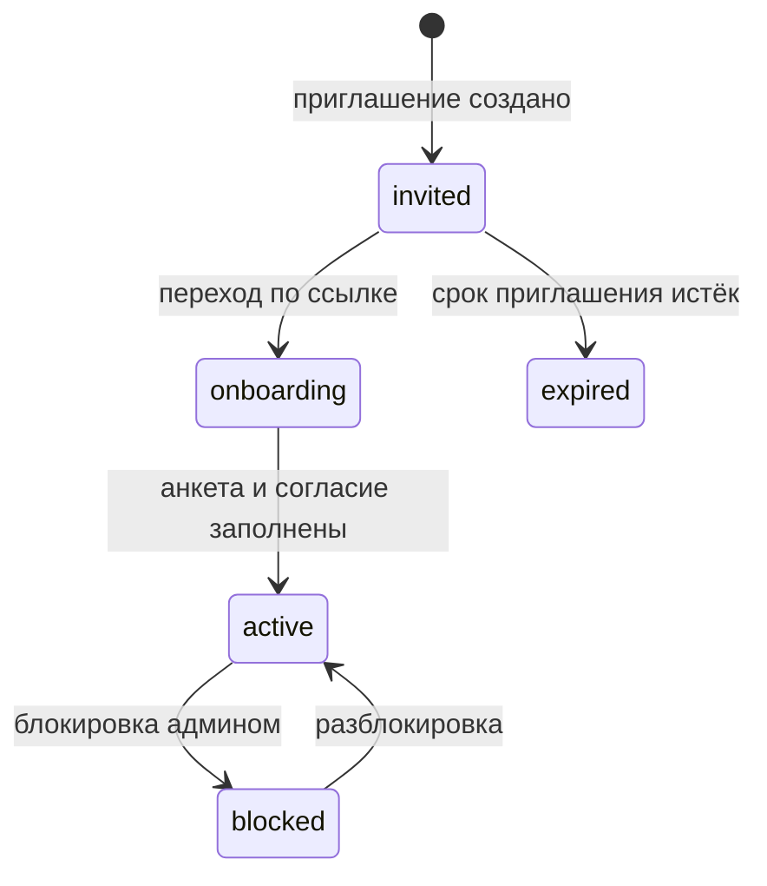
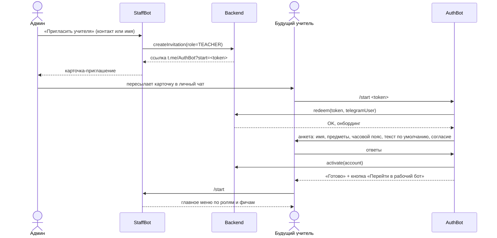
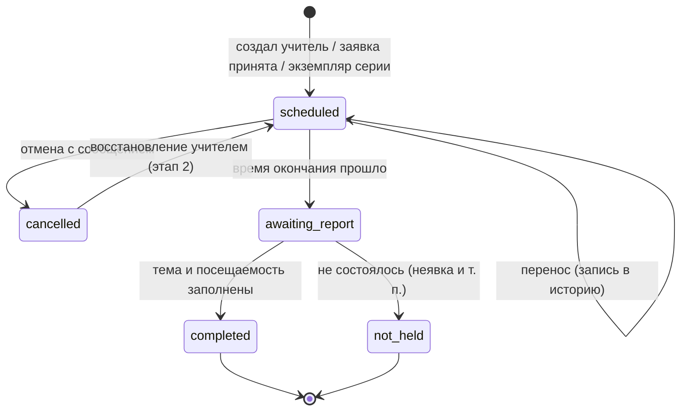
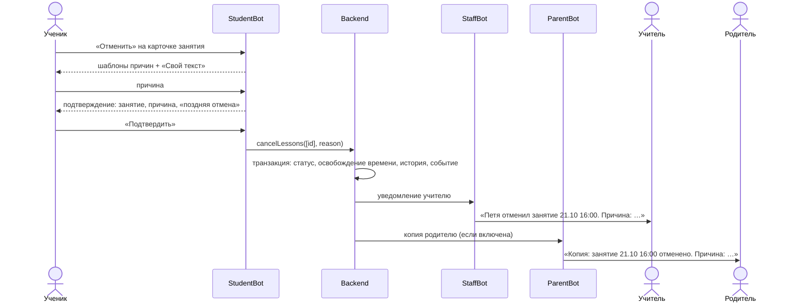
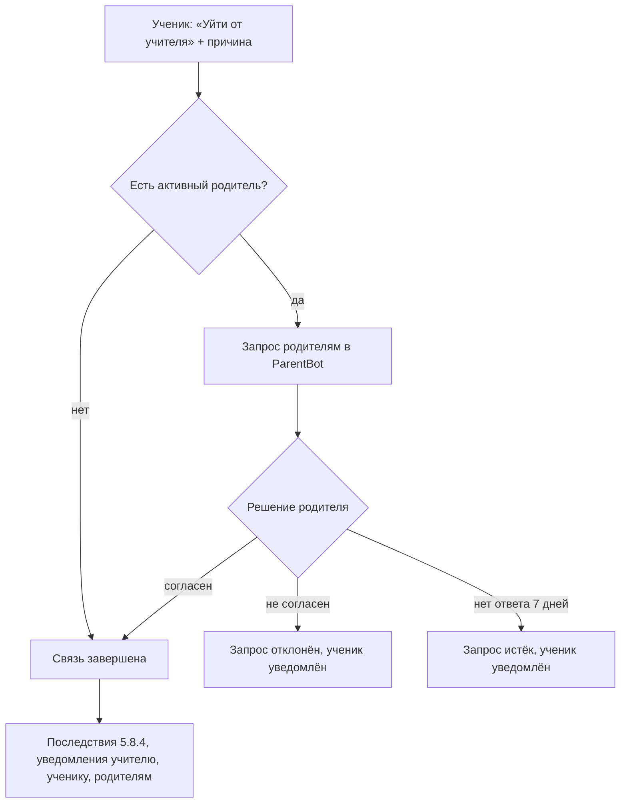
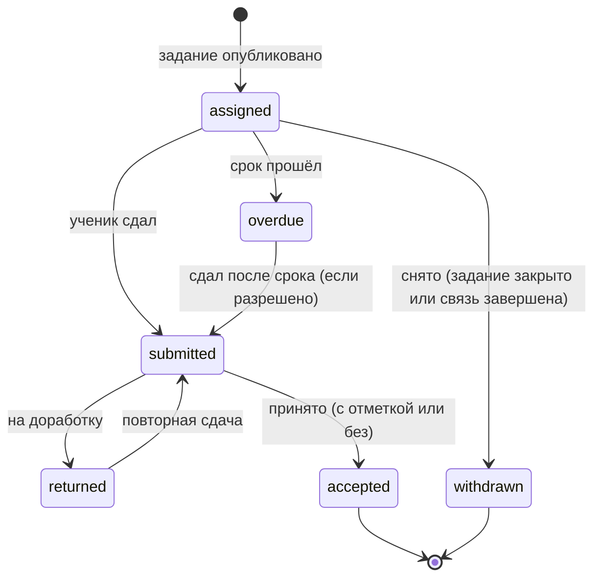
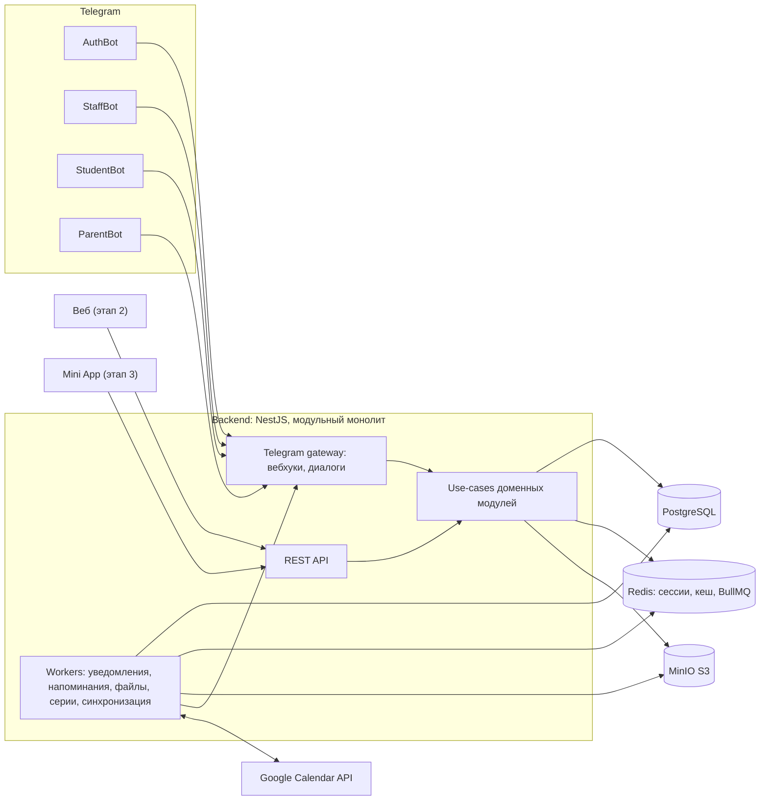
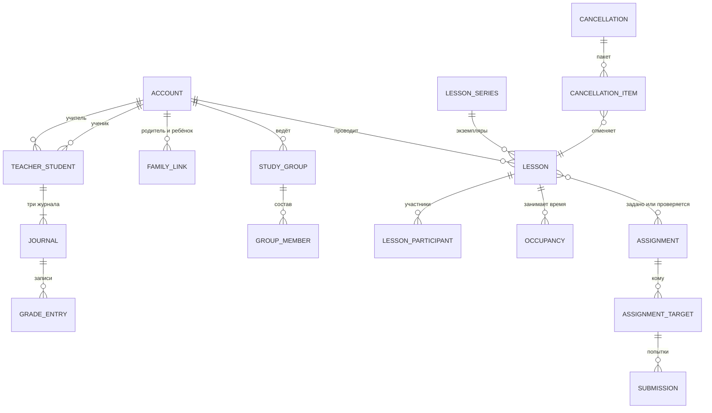

# Платформа для репетиторов и учителей — продуктовая спецификация

> **Статус:** черновик v0.2 · **Дата:** 2026-10-19
> **Рабочее название:** _Tutor Platform_ (TBD)
> **Объём MVP:** backend + четыре Telegram-бота. Веб-интерфейс и вход в него — этап 2, Telegram Mini App — этап 3.
> **v0.2:** внесены решения по вопросам 1–32 (журнал решений — в [разделе 12](#12-журнал-решений-и-открытые-вопросы)).

**Легенда**

- Без пометок — требования из исходной идеи и принятые решения.
- 💡 — предложение или значение по умолчанию, добавленное при проработке; можно поменять без пересмотра требований.
- ❓ — открытый вопрос (сводный список — в [разделе 12](#12-журнал-решений-и-открытые-вопросы)).
- `Р-NN` — ссылка на принятое решение из журнала решений (раздел 12).
- Коды правил (`CAL-01`, `LES-03`, …) — для ссылок из задач, тестов и обсуждений.

## Содержание

1. [Обзор продукта](#1-обзор-продукта)
2. [Глоссарий](#2-глоссарий)
3. [Роли и права доступа](#3-роли-и-права-доступа)
4. [Каналы коммуникации: Telegram и веб](#4-каналы-коммуникации-telegram-и-веб)
5. [Функциональность по модулям](#5-функциональность-по-модулям)
6. [Use-cases](#6-use-cases)
7. [Архитектура и стек](#7-архитектура-и-стек)
8. [Модель данных (черновик)](#8-модель-данных-черновик)
9. [API (черновик)](#9-api-черновик)
10. [Нефункциональные требования](#10-нефункциональные-требования)
11. [Дорожная карта](#11-дорожная-карта)
12. [Журнал решений и открытые вопросы](#12-журнал-решений-и-открытые-вопросы)

---

## 1. Обзор продукта

### 1.1 Идея

Платформа для частных репетиторов и учителей, которая снимает с них организационную рутину: расписание без накладок, приглашение учеников и родителей, материалы, домашние задания и их сдача, журналы результатов, напоминания и отчёты.

Основной канал — Telegram. Живое общение остаётся в обычных чатах Telegram (учитель ↔ ученик, учитель ↔ родитель), а всё «системное» (расписание, задания, сдачи, отметки, уведомления) идёт через ботов, позже — через веб-интерфейс и Mini App.

### 1.2 Какие проблемы решаем

| Проблема | Как решаем |
|---|---|
| Расписание в заметках и переписке, накладки | Календарь с гарантией отсутствия пересечений у учителя и ученика |
| Отмены «молча» и в последний момент | Отмена только с сообщением, фиксация поздних отмен, копия родителю |
| ДЗ и материалы теряются в переписке | Материалы и ДЗ — сущности платформы, привязанные к занятиям, подборкам и ученикам |
| Сдачи разбросаны по чатам | Сдача через бота, очередь проверки у учителя |
| Нет истории занятий | Занятие хранит дату, участников, тему, материалы, ДЗ, результаты |
| Родитель не видит прогресса | Копии сообщений и отчёты успеваемости |
| Школьные отметки и ЦТ ведутся в таблицах | Три журнала на ученика по каждому предмету, средний балл за период, динамика тестов |

### 1.3 Цели MVP

1. Учитель ставит занятие в 2–3 нажатия; система гарантирует, что у учителя и у ученика нет пересечений.
2. Каждое занятие имеет полную историю, тема после занятия заполняется обязательно.
3. Отмены возможны только с сообщением; все участники (и при настройке — родители) уведомлены.
4. Ученик сдаёт ДЗ через бота, учитель проверяет через бота.
5. На каждого ученика — три журнала результатов; отчёт уходит ученику и родителю.
6. Администратор управляет тем, кто имеет доступ к платформе и к каким функциям.

### 1.4 Принципы

1. **Telegram-first.** Всё необходимое для работы доступно в ботах. Веб и Mini App — дополнительные клиенты того же API.
2. **Занятие — центральная сущность.** К нему привязываются материалы, ДЗ, отметки, посещаемость, отмены, история изменений.
3. **Нет тихих отмен.** Любая отмена — с сообщением-причиной, и участники об этом узнают.
4. **Приватность календаря.** Каждый видит детали только своих занятий; чужие — только как «занято».
5. **Доступ управляется флагами.** Администратор решает, кому и какие функции доступны; он не руководит работой учителей.
6. **Ничего не удаляется физически.** Удаление = блокировка или архив, история сохраняется. 💡 Исключение — обезличивание персональных данных по законному запросу (см. 10.2).
7. **Один человек — один аккаунт, много ролей.** Идентификатор человека — Telegram user ID.
8. **Бот и веб — тонкие клиенты.** Бизнес-логика (use-cases) едина, интерфейсы её только вызывают.
9. **Учитель — владелец учебных данных.** Занятия, задания, сдачи, журналы и отчёты принадлежат учителю. Ученик и родитель — участники с производным правом чтения, которое вычисляется при каждом запросе из статуса аккаунта, статуса связи и факта участия (см. 8.0).
10. **Платные ограничения — только у учителя.** Ученик и родитель не упираются в лимиты и отключённые фичи напрямую: их возможности следуют за настройками учителя (см. 5.3.3).

### 1.5 Границы

**Входит в MVP:** роли и доступ, приглашения по персональной ссылке, четыре бота, ученики, родители и группы, календарь с окнами и заявками, занятия (разовые и регулярные), отмены (в том числе массовые) и переносы, материалы и плоские подборки, ДЗ и сдача, три журнала по каждому предмету, отчёт успеваемости вручную, уведомления, напоминания и утренняя сводка, копии родителям, ICS-подписка, аудит. REST API проектируется сразу (OpenAPI), но веб-клиент и вход в веб не делаются.

**Перенесено на этап 2** (решение `Р-30`, подробности в 11.2): вход в веб и сессии, групповые ссылки, QR и выбор контакта при добавлении ученика, импорт CSV, объявления, картинки в кастомном журнале, голосовые сдачи и очистка EXIF, встречное предложение по заявке, восстановление отменённого занятия, подтверждение «Буду», автоматический черновик отчёта, разделы в подборках, статистика для админа, пресеты фич, Telegram-группы классов, Google Calendar, четверти и годовые отметки, другие шкалы школьного журнала.

**Не входит сейчас:**

- 💡 Учёт оплат и абонементов — сильный кандидат на этап 3 (у репетиторов это частая боль).
- Видеосвязь (используются внешние ссылки: Zoom, Meet, звонок Telegram).
- Маркетплейс репетиторов и поиск учеников.
- Внутренний мессенджер: живое общение — в нативных чатах Telegram.
- Автоматическая проверка заданий.
- Отдельные аккаунты для учеников без Telegram: родитель ведёт аккаунт ребёнка сам (см. 4.3).

---

## 2. Глоссарий

| Термин | Определение |
|---|---|
| **Платформа** | Вся система: backend, боты, веб, Mini App |
| **Аккаунт** | Запись о человеке. Идентифицируется Telegram user ID; аккаунтов без Telegram нет |
| **Staff** | Аккаунты с ролями суперадмин, админ, учитель: работают в AuthBot и StaffBot, с этапа 2 — в вебе |
| **AuthBot** | Служебный бот staff: приглашения и онбординг; с этапа 2 — коды входа в веб и уведомления безопасности. Не рабочий |
| **StaffBot** | Рабочий бот учителя и админа: управление. Позже в нём будет Mini App |
| **StudentBot** | Бот ученика: расписание, заявки, ДЗ и сдачи, материалы, журналы, уведомления (см. 4.3) |
| **ParentBot** | Бот родителя: расписание и успеваемость детей, копии сообщений, отчёты, согласия, отмены за ребёнка (см. 4.3) |
| **Предмет** | Справочник платформы (математика, физика, …); пополняет админ. Учитель выбирает свои предметы из него |
| **Связь учитель–ученик** | Отношение «ученик занимается у учителя». Имеет статус и историю. Удаление ученика у учителя = завершение связи, а не удаление аккаунта |
| **Семейная связь** | Отношение «родитель — ученик». Не зависит от учителя |
| **Группа (класс)** | Набор учеников одного учителя для групповых занятий и массовой выдачи ДЗ |
| **Занятие** | Запланированная встреча учителя с учеником или группой; имеет историю |
| **Серия** | Правило повторения занятий (например, по вторникам и четвергам в 16:00) |
| **Окно** | Интервал, в который учитель готов проводить занятия (основа «открытого календаря») |
| **Занятость** | Интервал, когда человек занят (занятие или личный блок учителя) |
| **Заявка (booking)** | Предложение ученика провести или перенести занятие на открытый слот учителя. Заявка не занимает время (см. 5.5.5) |
| **Лимит занятий в неделю** | Максимум занятий ученика у учителя за неделю; задаёт учитель при приглашении. Ограничивает заявки ученика, не учителя |
| **Материал** | Файл, ссылка или текст для самостоятельного изучения |
| **Подборка** | Именованный упорядоченный набор материалов и заданий: курс, тема, «материалы за ноябрь» и т. п. |
| **Выдача** | Предоставление ученику или группе доступа к материалу, подборке или заданию |
| **ДЗ (задание)** | Задание с условием, сроком и правилами сдачи |
| **Сдача** | Попытка ученика выполнить задание: файлы и/или текст |
| **Журнал** | Набор записей о результатах ученика по одному предмету и одного типа: школьные отметки, тесты (ЦТ/ЦЭ/РТ), кастомная шкала |
| **Шкала** | Набор допустимых значений отметки: 10-балльная для школьного журнала (другие числовые — этап 2) или кастомная (2–10 значений) |
| **Период** | Произвольный диапазон дат (месяц, диапазон) для среднего балла и отчёта. Четверти и годовые отметки — этап 2 |
| **Тип сообщения** | Категория уведомления (напоминание, отмена, ДЗ, отчёт, …). Для каждого типа настраиваются получатели и копия родителю |
| **Копия родителю (CC)** | Дублирование сообщения определённого типа родителям ученика |
| **Фича (флаг)** | Отключаемая функция платформы; доступ выдаёт админ |

---

## 3. Роли и права доступа

### 3.1 Модель

- **Аккаунт = человек.** Ключ — Telegram user ID; username и имя обновляются при каждом взаимодействии (они меняются).
- **Роли:** `SUPER_ADMIN`, `ADMIN`, `TEACHER`, `STUDENT`, `PARENT`. У аккаунта может быть несколько ролей: админ + учитель, учитель + родитель, учитель, который сам учится у другого учителя.
- **Платформенные роли** (`ADMIN`, `TEACHER`) выдаются явно: админа назначает суперадмин, учителя приглашает админ.
- **Контекстные роли** (`STUDENT`, `PARENT`) возникают из связей: ученик — через связь с учителем, родитель — через семейную связь с учеником.
- **Права = роль + контекст.** Учитель работает только со своими учениками (активная связь), родитель — только со своими детьми. Проверка контекста обязательна в каждом use-case, а не только в UI.
- **Каналы по ролям:** staff → AuthBot + StaffBot (веб — этап 2); ученик → StudentBot; родитель → ParentBot (Mini App — этап 3). Человек с несколькими ролями пользуется несколькими ботами; переключателя ролей внутри бота нет. Отдельного авторизационного аккаунта у ученика и родителя нет.

### 3.2 Суперадмин (`SUPER_ADMIN`)

- Ровно один на платформу (гарантируется уникальным ограничением в БД).
- Создаётся при развёртывании (bootstrap, см. 5.1.1).
- Может всё, что может админ, плюс назначает и снимает админов, блокирует админов.
- Смена суперадмина — **только** через системный API с ключом (см. 5.3.4). В интерфейсах ботов и веба такого действия нет.
- Не может быть заблокирован через интерфейс.

### 3.3 Администратор (`ADMIN`)

Админ управляет **доступом**, а не работой учителей.

- Приглашает учителей. **Только админ (или суперадмин) может пригласить учителя.**
- Блокирует и разблокирует учителей, учеников и родителей на уровне платформы. Физического удаления нет — только блокировка (данные сохраняются, разблокировка возвращает доступ).
- Включает и выключает фичи и интеграции для каждого учителя, задаёт лимиты (квота хранилища, число учеников и т. п.), управляет глобальными значениями по умолчанию.
- Пополняет справочник предметов платформы (`Р-31`) и список допустимых типов файлов.
- Видит всё: календари, занятия, журналы — в режиме чтения. 💡 Факт просмотра чужих данных пишется в аудит.
- Может одновременно иметь роль учителя и работать как обычный учитель.
- **Не делает:** не назначает учеников учителям, не создаёт и не правит занятия, ДЗ, журналы учителей.
- 💡 Исключение: при блокировке учителя или ученика админ решает судьбу их будущих занятий (отменить с сообщением или оставить при временной блокировке).

### 3.4 Учитель (`TEACHER`)

- Управляет учениками и родителями **в своём контексте**: добавляет учеников к себе по персональной ссылке и убирает их от себя (не с платформы). При приглашении задаёт лимит занятий в неделю (5.4.2).
- Приглашает родителей к ученикам (только учитель, 5.4.3), ставит родителей в копию сообщений определённых типов. Пригласить родителя несовершеннолетнего — ответственность учителя (`Р-26`).
- Создаёт группы (классы), управляет составом.
- Настраивает окна, открытость календаря, режим подтверждения заявок, буферы между занятиями, разрешения на отмену для учеников и родителей, текст по умолчанию для отмен и переносов.
- Ставит занятия (разовые и регулярные) в любое свободное время, включая закрытые для учеников часы (`Р-22`); переносит, отменяет (с сообщением), заполняет итоги: тема, посещаемость, отметки.
- Загружает материалы, собирает подборки, выдаёт доступ.
- Выдаёт ДЗ, проверяет сдачи, возвращает на доработку, ставит отметки.
- Ведёт журналы, настраивает кастомную шкалу, формирует отчёты.
- Отказывается от ученика — все будущие занятия с ним отменяются автоматически.
- Живое общение — напрямую в чате Telegram; всё остальное — через StaffBot или веб.

### 3.5 Ученик (`STUDENT`)

- В основном получает сообщения от учителя (в личном чате) и от StudentBot.
- Видит своё расписание у всех учителей и свободные слоты учителя, если у того открыт календарь.
- Бронирует открытые слоты (сразу или заявкой — по режиму учителя) и просит о переносе (всегда через подтверждение учителем) — в пределах лимита занятий в неделю.
- Отменяет свои занятия — только с сообщением и только до начала занятия; массово — за период или у конкретного учителя за период. Учитель может отключить отмену для своих учеников.
- Сдаёт ДЗ через бота, загружает файлы из ограниченного списка типов с лимитами на размер и частоту загрузок.
- Видит выданные материалы и журналы (журналы открыты по умолчанию, учитель может скрыть любой).
- Видит своих учителей и может уйти от учителя: при наличии родителя — только с согласия родителя, без родителя — сам.
- Видит список своих родителей (кто получает копии), но не приглашает и не удаляет их — это делает учитель; иначе можно обойти согласие на уход.

### 3.6 Родитель (`PARENT`)

- Общается с учителем напрямую в чате Telegram.
- Получает отчёты от учителя и копии сообщений выбранных типов (ДЗ, отчёт, отмены и т. п.).
- Подтверждает или отклоняет уход ребёнка от учителя.
- Видит расписание, задания и (если открыто) журналы своих детей; может завершить занятия ребёнка у учителя сам.
- Отменяет занятия ребёнка (с сообщением, до начала занятия), в том числе массово за период; учитель может отключить это для родителей отдельно от учеников (`Р-2`, `Р-25`).
- Один родитель может быть привязан к нескольким детям, у ребёнка может быть несколько родителей.

### 3.7 Матрица прав

Обозначения: ✅ — может; 🔸 — может с ограничением (в скобках); 👁 — только чтение; — — нет.
Если у SA или админа есть роль учителя, в столбце «Учитель» для него действуют те же права в его учительском контексте.

| Действие | SA | Админ | Учитель | Ученик | Родитель |
|---|---|---|---|---|---|
| Назначить или снять админа | ✅ | — | — | — | — |
| Сменить суперадмина | 🔸 (только API + ключ) | — | — | — | — |
| Пригласить учителя | ✅ | ✅ | — | — | — |
| Заблокировать или разблокировать учителя, ученика, родителя | ✅ | ✅ | — | — | — |
| Заблокировать админа | ✅ | — | — | — | — |
| Включить или выключить фичи и лимиты учителя | ✅ | ✅ | — | — | — |
| Просмотр всех календарей, занятий, журналов | 👁 | 👁 | — | — | — |
| Добавить ученика к себе или убрать от себя | — | — | ✅ | — | — |
| Пригласить родителя к ученику | — | — | ✅ | — | — |
| Пополнять справочник предметов | ✅ | ✅ | — | — | — |
| Создавать группы | — | — | ✅ | — | — |
| Настраивать окна и открытость календаря | — | — | ✅ | — | — |
| Создать занятие | — | — | ✅ (в любое свободное время) | 🔸 (открытый слот, в пределах лимита в неделю; сразу или заявкой) | — |
| Перенести занятие | — | — | ✅ | 🔸 (заявка, всегда с подтверждением) | — |
| Отменить занятие (с сообщением) | 🔸 (при блокировке) | 🔸 (при блокировке) | ✅ (до окончания) | ✅ (свои, до начала; учитель может отключить) | ✅ (за ребёнка, до начала; учитель может отключить) |
| Отметить «не состоялось» | — | — | ✅ | — | — |
| Массовая отмена | — | — | ✅ | ✅ (свои) | ✅ (за ребёнка) |
| Видеть занятость ученика у других учителей | 👁 (с деталями) | 👁 (с деталями) | 🔸 (только «занято») | — | — |
| Видеть свободные слоты учителя | — | — | — | 🔸 (календарь открыт) | — |
| Загружать материалы, выдавать ДЗ | — | — | ✅ | — | — |
| Сдавать ДЗ | — | — | — | ✅ | — |
| Проверять ДЗ, ставить отметки | — | — | ✅ | — | — |
| Видеть журналы | 👁 | 👁 | ✅ (свои ученики) | 🔸 (открыты по умолчанию, учитель может скрыть) | 🔸 (открыты по умолчанию, учитель может скрыть) |
| Внести школьную отметку | — | — | ✅ | 💡🔸 (на подтверждение) | 💡🔸 (на подтверждение) |
| Получать копии сообщений | — | — | — | — | ✅ (по настройке) |
| Уйти от учителя | — | — | — | 🔸 (с согласия родителя) | ✅ (за ребёнка) |
| Подтвердить уход ребёнка | — | — | — | — | ✅ |
| Отказаться от ученика | — | — | ✅ | — | — |
| Вход в веб-интерфейс (этап 2) | ✅ | ✅ | ✅ | — | — |

### 3.8 Жизненные циклы

**Аккаунт**



- `blocked`: боты отвечают «Доступ ограничен, обратитесь к администратору», веб-сессии отзываются, уведомления этому аккаунту не отправляются, данные сохраняются.
- Ученик и родитель проходят `onboarding` в упрощённом виде: подтверждение связи, имя, часовой пояс, согласие на обработку данных (родитель — также как законный представитель ребёнка).

**Связь учитель–ученик:** `pending` (ссылка выдана, не принята) → `active` → `ended`.
Причина завершения: `removed_by_teacher` | `left_by_student` | `ended_by_parent` | `system` (блокировка). Повторное добавление создаёт новый период активности, история сохраняется.

**Семейная связь:** `pending` → `active` → `revoked`. Создаёт её только учитель; отозвать могут родитель, учитель, который её создал, или админ. Ученик — нет.

---

## 4. Каналы коммуникации: Telegram и веб

### 4.1 Ограничения Telegram, влияющие на дизайн

| Ограничение | Следствие для продукта |
|---|---|
| Бот не может написать первым: пользователь должен сам открыть бота (`/start`) | Все приглашения — deep link `t.me/<bot>?start=<token>`. Ссылку доставляет человек (админ или учитель): бот готовит карточку-приглашение, приглашающий пересылает её адресату. Написать напрямую бот может только тому, кто уже открывал этого бота |
| Параметр deep link — до 64 символов из `A-Z a-z 0-9 _ -` | В ссылке — короткий случайный одноразовый токен, всё остальное хранится на сервере |
| Бот не может найти пользователя по username или телефону | User ID получаем при переходе по ссылке, через кнопку выбора контакта (`request_users`) или пересланный контакт |
| Бот не может создавать группы | Группы создаёт человек и добавляет туда бота (только для опционального режима групп, 4.3) |
| В группе с включённым privacy mode бот видит только команды и ответы на свои сообщения | Бот не читает переписку — это плюс для приватности |
| Лимиты отправки: около 1 сообщения в секунду в один чат, около 20 в минуту в группу, около 30 в секунду на бота суммарно | Очередь отправки с ограничением скорости; агрегирование (массовая отмена = одно сообщение получателю) |
| Файлы в облачном Bot API: бот скачивает до 20 МБ и отправляет до 50 МБ; с собственным Bot API сервером — до 2000 МБ | В MVP лимит файла сдачи — 20 МБ; большие материалы — временной ссылкой на скачивание |
| `file_id` действует только для того бота, который его получил | Файл из StudentBot нельзя переслать через StaffBot или ParentBot по `file_id`. Источник истины — S3, `file_id` кешируется отдельно для каждого бота |
| `callback_data` кнопки — до 64 байт | Состояние диалога хранится на сервере (Redis), в кнопке — короткий ключ |
| Пользователь может заблокировать бота (ошибка 403) | Канал помечается недоступным, учитель получает предупреждение, 💡 при настройке сообщения уходят родителю |

### 4.2 Боты

| Бот | Кто пользуется | Назначение |
|---|---|---|
| **AuthBot** | SA, админы, учителя | Принятие приглашения, онбординг (анкета, часовой пояс, согласие на обработку данных). После онбординга выдаёт ссылку на StaffBot. Этап 2: коды и подтверждения входа в веб, список сессий, «выйти на всех устройствах», уведомления безопасности. Рабочих функций нет |
| **StaffBot** | SA, админы, учителя | Рабочий бот: раздел «Учитель» (ученики, группы, занятия, календарь, материалы, ДЗ, проверка, журналы, отчёты, настройки) и раздел «Администрирование» для админов. Меню строится по ролям и включённым фичам. Позже здесь появится Mini App |
| **StudentBot** | Ученики | Расписание, запись на открытые слоты, отмены, ДЗ и сдачи, материалы, журналы, отчёты, мои учителя, архив, уведомления |
| **ParentBot** | Родители | Дети, расписание и задания ребёнка, успеваемость и отчёты, копии сообщений, отмены за ребёнка, согласия, настройки уведомлений |

**Почему AuthBot отдельно от StaffBot.** Коды и уведомления безопасности (этап 2) не теряются среди рабочих сообщений; рабочий бот можно заглушить, не пропустив код; у каждого токена меньше полномочий; рабочего бота можно пересоздать, не затрагивая вход.

**Почему боты ученика и родителя отдельные (`Р-21`).** Разные сценарии и меню; у каждого бота свой лимит отправки; родитель не видит ученических команд, ученик — родительских. Аккаунт с двумя ролями (учитель, который родитель; взрослый ученик, который сам родитель) не требует переключателя ролей — у каждой роли свой бот.

**Технически:** одна кодовая база и один шлюз, который обслуживает четыре токена; у каждого бота свой набор обработчиков и своя очередь отправки.

### 4.3 Как ученик и родитель получают системные сообщения

Нужно было решить: отдельный чат с ботом или бот, добавленный в чат учителя с учеником.

| Вариант | Плюсы | Минусы |
|---|---|---|
| **A. Личные чаты с ботами:** StudentBot у ученика, ParentBot у родителя | Приватно; работает сразу после перехода по ссылке; не нужно создавать группы; все учителя ученика — в одном месте; сдачи и отметки видит только адресат | Системные сообщения отделены от живой переписки с учителем |
| **B. Бот в группе «учитель + ученик (+ родитель)»** | Всё в одном чате; родитель видит всё | Учитель вручную создаёт группу на каждого ученика (боты не умеют создавать группы); бот-админ видит всю переписку; лимит 20 сообщений в минуту на группу; сложно с несколькими учителями |
| **C. Гибрид** | A как основной канал; Telegram-группы класса — для объявлений | Две модели доставки — больше логики |
| **D. Telegram Business** | Бот пишет в нативные личные чаты от имени учителя | Нужен Telegram Premium у каждого учителя; по текущим правилам бизнес-бот отвечает только в чатах с входящими сообщениями за последние 24 часа — напоминания так не работают (требует проверки) |

💡 **Решение:** вариант **C**. В MVP — только **A**; привязка Telegram-групп — этап 2 под флагом `groups.telegram`; **D** — исследование на будущее.

**Правила для личного чата (A):**

- Каждое сообщение подписано учителем и предметом; где уместно — кнопка «Написать учителю», ссылка на личный чат (`t.me/<username>`, если у учителя есть username).
- Бот — не мессенджер: произвольные ответы ученика учителю не пересылаются, бот подсказывает написать в личный чат. Структурированные ответы обрабатываются: причина отмены, комментарий к сдаче, сообщение к заявке.
- **Ученик без Telegram** (младший школьник) в MVP отдельно не поддерживается (`Р-12`): родитель сам принимает ссылку ученика в StudentBot и ведёт аккаунт ребёнка (имя аккаунта — имя ребёнка). Ограничения: один Telegram-аккаунт — один аккаунт ученика (`PPL-02`), поэтому двух детей без Telegram так завести нельзя; согласие родителя на уход (`LINK-02`) к такому аккаунту не применяется.

**Привязка Telegram-группы (этап 2):**

1. Учитель создаёт группу класса в Telegram и добавляет туда StudentBot.
2. В группе вызывает `/link <код>`; код выдаёт StaffBot для конкретной группы платформы.
3. Privacy mode включён — бот не читает переписку.
4. В группу дублируются объявления, ДЗ группы и изменения её расписания. Личное (отметки, сдачи, результаты проверки) в группу **никогда** не попадает.

### 4.4 Меню ботов (MVP)

**AuthBot (MVP):** `/start` (приглашение, онбординг), `/help`. Этап 2: `/login` (код входа), `/sessions`, `/logout_all`.

**StaffBot, раздел «Учитель»:**

- 📅 **Сегодня / Неделя** — занятия, действия на карточке занятия.
- ➕ **Занятие** — быстрое создание.
- 👥 **Ученики** — список, карточка ученика, «Добавить ученика».
- 🧑‍🤝‍🧑 **Группы**.
- 📚 **Материалы и подборки**.
- 📝 **Задания** — «На проверке (N)», активные, создать.
- 📊 **Журналы и отчёты**.
- ⚠️ **Требует внимания** — занятия без темы, непроверенные сдачи, заявки учеников.
- ⚙️ **Настройки** — профиль и предметы, окна, открытый календарь и режим подтверждения заявок, буферы, разрешения на отмену для учеников и родителей, текст по умолчанию и шаблоны причин, уведомления, копии родителям, кастомная шкала.

**StaffBot, раздел «Администрирование»:** учителя (пригласить, список, блокировка), пользователи (поиск, блокировка), фичи и лимиты, приглашения, справочник предметов, типы файлов, аудит; у SA — ещё управление админами. Статистика — этап 2.

**StudentBot:** 📅 Расписание · ➕ Записаться (если у учителя открыт календарь) · 📝 Задания · 📚 Материалы · 📊 Успеваемость · ❌ Отменить занятие · 👩‍🏫 Мои учителя (карточка учителя: предмет, «Написать учителю», «Попросить о переносе», «Прекратить занятия») · 👨‍👩‍👧 Родители (только просмотр) · 🗂 Архив · ⚙️ Настройки.

**ParentBot:** 👧 Дети (переключение ребёнка) · 📅 Расписание ребёнка (с отменой, в том числе массовой) · 📝 Задания ребёнка (чтение) · 📊 Успеваемость и отчёты · 👩‍🏫 Учителя ребёнка («Написать учителю», «Завершить занятия») · ✅ Запросы (согласия) · ⚙️ Настройки уведомлений.

**Принципы UX в ботах:**

- **Действия на месте.** На напоминании и карточке занятия — «Отменить», «Перенести», «Итоги»; на уведомлении о сдаче — «Принять», «На доработку», «Оценить».
- **Одно сообщение-меню**, которое редактируется, а не множится в чате.
- **Списки с пагинацией**, недавние ученики сверху.
- **Ввод времени** — кнопками или текстом («16:30», «завтра 16:30»).
- **Команды по ролям:** список команд выставляется отдельно для каждого чата (`setMyCommands` со scope).
- **Все тексты — через i18n** (русский по умолчанию).

### 4.5 Веб-интерфейс и Mini App (позже)

- **Веб (этап 2)** — для админов и учителей: ученики, группы, календарная сетка, материалы и файлы, сдачи, журналы и графики успеваемости, настройки; для админов — пользователи, фичи, аудит. Вход по коду из AuthBot (5.2).
- **Mini App (этап 3)** — в StaffBot: тот же клиент, адаптированный под Telegram. Авторизация по `initData`, подписанным Telegram (проверка HMAC на ключе бота), без кодов. Позже — Mini App в StudentBot и ParentBot (календарь, графики).
- Веб и Mini App работают через тот же REST API и те же use-cases, что и боты.

---

## 5. Функциональность по модулям

### 5.1 Приглашения и онбординг (INV)

#### 5.1.1 Bootstrap суперадмина

1. При первом развёртывании задаётся переменная окружения `BOOTSTRAP_SUPERADMIN_TELEGRAM_ID`.
2. Команда `seed:superadmin` создаёт аккаунт с ролью `SUPER_ADMIN` в статусе `invited` и выводит в лог одноразовую ссылку `t.me/<AuthBot>?start=<token>` (срок 24 часа).
3. Ссылку примет только Telegram-пользователь с этим ID.
4. Повторный запуск при существующем SA ничего не делает (идемпотентно).

#### 5.1.2 Приглашение учителя и админа

**Правила**

- `INV-01` Учителя приглашает только админ или SA. Админа назначает только SA: новому человеку — приглашением с ролью `ADMIN`, существующему учителю — выдачей роли.
- `INV-02` Приглашение одноразовое, 💡 действует 72 часа, его можно отозвать до использования.
- `INV-03` Если при создании выбран контакт Telegram (`request_users`), приглашение привязывается к его user ID; другой человек по этой ссылке получит отказ «Приглашение адресовано не вам».
- `INV-04` Если адресат уже есть на платформе (например, как родитель), приглашение добавляет роль к существующему аккаунту.
- `INV-05` Токен хранится только в виде хеша.

**Сценарий**



**Анкета онбординга учителя:** имя и фамилия (предзаполнены из Telegram), предметы (выбор из справочника платформы, `Р-31`), часовой пояс (💡 по умолчанию — часовой пояс платформы, например `Europe/Minsk`), язык, длительность занятия по умолчанию, текст по умолчанию для отмен и переносов (предзаполнен платформенным шаблоном; учителя просят написать свой, `Р-8`), согласие с условиями и политикой обработки данных (версия документа фиксируется). Если у аккаунта нет username, AuthBot просит его установить — он понадобится для входа в веб (этап 2).

**Переход в StaffBot:** обычная ссылка на бота. StaffBot узнаёт пользователя по Telegram ID; если онбординг не пройден или аккаунт заблокирован — отказ с подсказкой.

Приглашение ученика — см. 5.4.2, родителя — см. 5.4.3.

### 5.2 Вход в веб-интерфейс (AUTH) — этап 2

> Перенесено на этап 2 вместе с вебом (`Р-29`): в MVP нет кодов, сессий и команд `/login`, `/sessions`, `/logout_all`, AuthBot выполняет только онбординг. Требования ниже сохраняются для этапа 2.

**Единственный способ — username и код из AuthBot (`Р-16`):**

1. На странице входа пользователь вводит `@username`.
2. Если такой активный staff-аккаунт есть, AuthBot присылает 6-значный код: живёт 5 минут, 5 попыток ввода. В сообщении указано, с какого устройства и браузера запрошен вход.
3. Пользователь вводит код и получает сессию.

- `AUTH-01` Ответ страницы одинаков, есть аккаунт или нет, — перебором нельзя узнать, кто зарегистрирован.
- `AUTH-02` Ограничение частоты: на аккаунт (💡 3 кода за 15 минут) и на IP.
- `AUTH-03` Коды хранятся в Redis только в виде хеша.
- `AUTH-04` Вход привязан к username: он обязателен для staff и обновляется при каждом апдейте Telegram. Устаревший username, занятый другим человеком, даёт лишь лишнее уведомление «кто-то запросил вход» прежнему владельцу — код уходит в чат аккаунта, доступ не утекает.

Вход кнопкой или QR в AuthBot не планируется (`Р-16`).

**Сессии:** access token на 15 минут и refresh token с ротацией (хранится хеш). Список устройств и «выйти везде» — в AuthBot и вебе. О каждом новом входе приходит уведомление в AuthBot. При блокировке аккаунта все сессии отзываются сразу.

Ученики и родители в веб не входят; в Mini App авторизация идёт по `initData`.

### 5.3 Управление доступом и фичами (ACCESS)

#### 5.3.1 Модель флагов

- **Три уровня:** глобальный выключатель фичи на платформе → значение по умолчанию для новых учителей → персональное значение для учителя.
- **Итоговое значение:** `enabled = global AND (personal ?? default) AND все зависимости включены`.
- **Лимиты** — часть настройки фичи: квота хранилища, максимум учеников, групп, размер файла.
- **Пресеты** («Базовый», «Расширенный») — этап 2, задел под тарифы. Монетизация (`Р-20`): платят только учителя; конкретная модель (фичи, подписка или их сочетание) не выбрана. Флаги и лимиты уже живут на стороне учителя, поэтому любая модель ляжет на них без переделки.

**Ядро (не отключается):** аккаунты, роли, приглашения, связи; календарь (`Р-1`): окна, просмотр недели и занятости, регулярные серии, личные блоки учителя, «Сегодня / Завтра / Неделя»; занятия (создание, перенос, отмена с сообщением, итоги, история); гарантия отсутствия пересечений (`CAL-01`); базовые уведомления и напоминания о занятиях. Фичи календаря — только надстройки: открытый календарь, ICS, Google Calendar.

#### 5.3.2 Каталог фич (MVP)

| Ключ | Что даёт | Зависит от | По умолчанию |
|---|---|---|---|
| `calendar.open_booking` | Открытый календарь: ученики видят открытые слоты и записываются (сразу или заявкой, 5.5.5) | — | выкл |
| `calendar.google` | Синхронизация с Google Calendar (этап 2) | — | выкл |
| `calendar.ics` | ICS-подписка на расписание | — | вкл |
| `groups` | Группы и классы, групповые занятия | — | вкл |
| `groups.telegram` | Привязка Telegram-групп (этап 2) | `groups` | выкл |
| `storage` | Файловое хранилище учителя с квотой; сдачи учеников расходуют квоту учителя (`Р-27`) | — | вкл, 💡 2 ГБ |
| `materials` | Материалы, плоские подборки, выдачи | `storage` | вкл |
| `homework` | Домашние задания | — | вкл |
| `homework.submissions` | Сдача файлов через бота | `homework`, `storage` | вкл |
| `journal.school` | Школьные отметки по 10-балльной шкале, средний балл за период | — | вкл |
| `journal.tests` | Тесты: ЦТ, ЦЭ, РТ, пробные | — | вкл |
| `journal.custom` | Кастомный журнал со своей шкалой (текст и эмодзи; картинки — этап 2) | — | вкл |
| `reports` | Отчёты успеваемости | — | вкл |
| `parents.cc` | Копии сообщений родителям | — | вкл |
| `invite.group_link` | Добавление учеников по групповой ссылке, QR, выбор контакта (этап 2) | — | выкл |
| `bulk.cancel` | Массовая отмена за период | — | вкл |
| `broadcasts` | Объявления ученикам и группам (этап 2) | — | выкл |
| `web` | Веб-интерфейс и вход в него (этап 2) | — | выкл |
| `miniapp` | Mini App в StaffBot (этап 3) | — | выкл |

#### 5.3.3 Поведение при выключении фичи

- Пункты меню скрываются, API отвечает ошибкой `FEATURE_DISABLED`.
- Данные не удаляются и возвращаются при повторном включении.
- Фоновые процессы фичи приостанавливаются (синхронизация Google, автоотчёты).
- Возможности учеников следуют за фичами учителя: если у учителя выключена `homework.submissions`, ученик не может сдать ему файл.
- Незавершённое закрывается с уведомлением: при выключении `calendar.open_booking` ожидающие заявки отклоняются с системным сообщением.
- Значения флагов кешируются в Redis и сбрасываются при изменении; каждое изменение пишется в аудит.

#### 5.3.4 Блокировка и смена суперадмина

**Блокировка**

- `ACC-01` Блокировка — это статус `blocked` с причиной, автором и временем. Удаления нет. Заблокированный ученик не видит ничего, включая «Архив» (`Р-6`).
- `ACC-02` При блокировке учителя или ученика админ выбирает судьбу будущих занятий: «отменить все с сообщением» (текст обязателен) или «оставить» (временная блокировка; напоминания не отправляются).
- `ACC-03` Разблокировка возвращает доступ и все данные.
- `ACC-04` Пока учитель заблокирован, его связи с учениками ведут себя как завершённые (`Р-28`): у учеников история в «Архиве» только для чтения, материалы закрыты, напоминания и копии не отправляются, заявки отклоняются. Разблокировка возвращает связи в `active`.

**Смена суперадмина**

- Только запрос `POST /api/v1/system/super-admin/transfer` с заголовком `X-System-Key`.
- Ключ хранится в секретах окружения в виде хеша, сравнивается за постоянное время; частота запросов ограничена, 💡 доступ можно ограничить списком IP.
- Новым SA может стать только активный staff-аккаунт; 💡 он подтверждает назначение в AuthBot.
- Прежний SA становится админом или теряет роль (параметр запроса).
- Оба получают уведомление в AuthBot; операция пишется в аудит.
- Ротация ключа — сменой секрета и перезапуском.

### 5.4 Ученики, родители, группы (PEOPLE)

#### 5.4.1 Карточка ученика у учителя

- Имя из Telegram и 💡 псевдоним «как подписан у меня» (виден только этому учителю).
- Класс, школа (необязательно), предметы (из справочника; по каждому — свои три журнала), цели (например, целевой балл ЦТ), лимит занятий в неделю (`PPL-06`).
- Родители, настройки копий, открытость календаря для этого ученика.
- Личные заметки учителя (ученик их не видит).
- Занятия, ДЗ, материалы, журналы.

#### 5.4.2 Способы добавления ученика

| Способ | Как работает | Этап |
|---|---|---|
| **Персональная ссылка** (единственный в MVP) | Учитель (при желании заранее заводит карточку с именем) указывает предмет и лимит занятий в неделю (`PPL-06`, 💡 по умолчанию 2) и получает в StaffBot карточку-приглашение со ссылкой `t.me/<StudentBot>?start=<token>`, которую пересылает ученику. Ученик видит «Анна Петровна (математика) приглашает вас» и нажимает «Принять» или «Отклонить». Ссылка одноразовая, 💡 действует 7 дней | MVP, ядро |
| **Групповая ссылка** | Многоразовая ссылка группы или класса с лимитом использований и сроком. Каждое вступление — заявка, которую учитель подтверждает (или включено автоподтверждение). Ученик сразу попадает в группу | Этап 2, `invite.group_link` |
| **QR-код** | Та же персональная ссылка в виде картинки — для очных занятий | Этап 2 |
| **Выбор контакта** | Учитель выбирает человека из своих контактов Telegram. Если тот уже пользуется StudentBot — получает запрос «Учитель хочет добавить вас» с кнопками; если нет — учитель получает персональную ссылку для отправки | Этап 2 |
| **Импорт списка** | CSV через веб | Этап 2 |

Ученики без Telegram — см. 4.3 (`Р-12`): родитель принимает ссылку ученика сам.

**Правила**

- `PPL-01` Учитель не может искать учеников по платформе — только способами выше (приватность).
- `PPL-02` Один Telegram-пользователь — один аккаунт ученика, сколько бы учителей его ни пригласили.
- `PPL-03` Принятие ссылки — согласие ученика на связь с учителем. Для несовершеннолетнего учитель приглашает и родителя (5.4.3): родитель, принимая ссылку, подтверждает согласие как законный представитель. Пригласить родителя — ответственность учителя, платформа связь не блокирует (`Р-13`, `Р-26`). Юридическая проверка — к релизу (10.2).
- `PPL-04` Убрать ученика — завершить связь (5.8); аккаунт и история сохраняются.
- `PPL-05` Число учеников ограничено лимитом `max_students`, если он задан.
- `PPL-06` У каждой связи учитель–ученик есть лимит занятий в неделю (`max_lessons_per_week`, `Р-24`): задаётся при приглашении, меняется в карточке ученика, `NULL` — без лимита. Он ограничивает записи и заявки ученика: если на неделю у этого учителя уже назначено столько занятий (любого происхождения), новые заявки отклоняются с объяснением. Учителя лимит не ограничивает.

#### 5.4.3 Родители

- Приглашает родителя только учитель — из карточки ученика (`Р-4`): StaffBot выдаёт карточку-приглашение со ссылкой `t.me/<ParentBot>?start=<token>`, учитель пересылает её родителю.
- Родитель открывает ссылку, подтверждает «Я родитель (законный представитель) ученика N» и даёт согласие на обработку данных ребёнка. Связь становится активной, ученик получает уведомление.
- Семейная связь общая для всех учителей ученика: каждый учитель видит родителей своего ученика (`Р-4`).
- Отозвать связь могут родитель, учитель-инициатор, админ; ученик — нет. Ученик видит список своих родителей в StudentBot.
- 💡 У ученика до 4 родителей. Копии получают все активные родители, у которых включён этот тип сообщений.
- Родитель с несколькими детьми переключает ребёнка в ParentBot; сообщения подписаны именем ребёнка.

#### 5.4.4 Группы (классы)

- Название, предмет (из справочника), цвет или эмодзи, состав, длительность занятия по умолчанию, регулярное расписание (серия), привязанная Telegram-группа (этап 2).
- Ученик может состоять в нескольких группах одного учителя.
- Изменение состава влияет только на будущие занятия: новый участник добавляется в будущие занятия группы с проверкой его занятости — конфликтные занятия пропускаются, учитель получает их список; ушедший убирается из будущих занятий, его время освобождается.
- Групповые операции: занятие, ДЗ, выдача материалов, объявление, отметки за занятие.
- Группа архивируется, а не удаляется.

### 5.5 Календарь (CAL)

#### 5.5.1 Основные правила

- `CAL-01` **Пересечений нет.** У одного человека (учителя или ученика) не может быть двух активных записей занятости, пересекающихся по времени. Это гарантирует ограничение в БД (7.4), а не только проверка в коде. Правило действует всегда, независимо от фич.
- `CAL-02` Занятость ученика учитывается по всем его учителям: если ученик занят у учителя А, учитель Б не может поставить занятие на это время.
- `CAL-03` Интервалы полуоткрытые: занятие 15:00–16:00 не пересекается с занятием 16:00–17:00.
- `CAL-04` **Буфер.** Учитель задаёт перерыв до и после занятия (например, 10 минут); буфер входит в занятость учителя, но не ученика. Буфер фиксируется в записи занятости при создании или переносе занятия; изменение настройки действует только на новые записи.
- `CAL-05` **Время.** Хранится в UTC, у каждого аккаунта — часовой пояс (IANA). Показывается в часовом поясе получателя. Окна и серии задаются в часовом поясе учителя с учётом перехода на летнее время.
- `CAL-06` Попытка поставить занятие на занятое время отклоняется с понятной причиной без деталей: «У ученика в это время другое занятие».

#### 5.5.2 Что считается занятостью

| Источник | Чья занятость | Как блокирует |
|---|---|---|
| Запланированное занятие | Учитель (с буфером) и все участники | Жёстко (`CAL-01`) |
| Личный блок «занят» | Только учитель (`Р-17`) | Жёстко; учитель может снять блок |
| Событие из Google Calendar (этап 2) | Учитель | Мягко: ученикам время не показывается свободным, учитель получает предупреждение |

Заявка ученика занятость **не создаёт** (`Р-22`): удержаний слотов нет, см. 5.5.5.

#### 5.5.3 Видимость

| Кто смотрит | Свои занятия | Занятость ученика у других учителей | Окна и занятость учителя |
|---|---|---|---|
| Учитель | Всё подробно | Только «занято» и только у своих активных учеников | Своё — подробно |
| Ученик | Всё подробно, по всем учителям | — | «Свободно / занято» — только если у учителя открыт календарь для этого ученика |
| Родитель | Занятия своих детей подробно | — | — |
| Админ | Всё подробно, только чтение | Всё | Всё |

- `CAL-07` Ответ API о чужой занятости содержит только интервалы времени — без названия, учителя, предмета и участников.

#### 5.5.4 Окна

- **Еженедельные правила:** день недели и интервал (например, пн–пт 15:00–20:00, сб 10:00–14:00), период действия.
- **Исключения на даты:** закрыть день или интервал (праздник, отпуск), добавить разовое окно.
- `CAL-08` Для ученика окна — жёсткое ограничение: заявки возможны только внутри окон.
- `CAL-09` Для учителя окна не ограничение (`Р-22`): он ставит занятия в любое свободное время, включая закрытые для учеников часы (выходные, поздний вечер). Бот лишь помечает такое занятие «вне окна».
- **Открытые слоты** для ученика = окна − занятость учителя (занятия с буферами, личные блоки, события Google) − занятость ученика − время, на которое уже набралось N ожидающих заявок (режим с подтверждением, 5.5.5). Слоты нарезаются шагом сетки (15, 30 или 60 минут) под допустимые длительности.

#### 5.5.5 Открытый календарь и заявки (фича `calendar.open_booking`)

**Настройки учителя**

- Режим: закрыт / открыт для всех моих учеников / открыт для выбранных.
- Подтверждение заявок: **без подтверждения** (по умолчанию, `Р-7`) или **с подтверждением** учителем.
- Минимальный срок до начала (например, не позже чем за 12 часов).
- Горизонт (например, на 3 недели вперёд).
- Допустимые длительности и шаг сетки.
- В режиме с подтверждением — не больше N ожидающих заявок на одно и то же или пересекающееся время (💡 по умолчанию 2, `Р-22`).
- Лимит занятий в неделю у каждого ученика (`PPL-06`) действует в обоих режимах.

**Режим без подтверждения (по умолчанию)**

1. Ученик: «Записаться» → учитель (если их несколько) → день → открытый слот → длительность → комментарий (необязательно) → «Записаться».
2. Занятие создаётся сразу в одной транзакции вместе с занятостью всех участников (`CAL-01`); слот закрывается для остальных учеников и появляется в календаре учителя.
3. Учитель получает `lesson.created` с пометкой «записался ученик» и кнопками «ОК» и «Отменить» (отмена — с причиной, как обычная отмена, 5.7).
4. Если слот заняли секунду назад — «Этот слот уже занят» и обновлённый список.

**Режим с подтверждением**

1. Те же шаги выбора; создаётся заявка `pending`. Заявка **не занимает время** (`Р-22`): слот остаётся открытым, пока на него не наберётся N заявок.
2. Учитель получает заявку с кнопками «Подтвердить» и «Отклонить» (с сообщением). Если на одно время несколько заявок — список, учитель выбирает одну.
3. Подтверждение создаёт занятие через `CAL-01`. Остальные заявки, пересекающиеся с ним по времени, система отклоняет с сообщением «Слот занят» и списком открытых слотов (или «открытых слотов пока нет»).
4. Если при подтверждении время уже занято (учитель сам поставил занятие или другой ученик записался без подтверждения) — учитель видит ошибку, заявка отклоняется с тем же сообщением ученику.
5. Заявка истекает, когда её время перестаёт удовлетворять минимальному сроку до начала; ученик получает уведомление.
6. «Предложить другое время» — этап 2.

- `CAL-10` Гонки решает только ограничение БД при создании занятия (`CAL-01`); удержаний и блокировок на уровне заявок нет.
- Заявка на перенос всегда требует подтверждения учителем, независимо от режима (`Р-24`), и ссылается на существующее занятие (5.7.4).

#### 5.5.6 Регулярные занятия (серии)

- **Правило:** дни недели, время, длительность, дата начала, дата окончания или «без конца», участники (ученик или группа).
- Занятия серии создаются заранее на скользящий горизонт (💡 12 недель), фоновая задача продлевает его.
- **Конфликт** при создании экземпляра: экземпляр не создаётся, учитель получает список конфликтов с вариантами «перенести» и «пропустить».
- **Изменения:** «только это занятие», «это и последующие», «все будущие».
- **Пауза серии** на период (каникулы): новые экземпляры в этом периоде не создаются, уже созданные отменяются по правилам отмены (5.7).
- Отмена одного экземпляра не ломает серию. Завершение серии с даты — отмена всех будущих экземпляров с сообщением.

#### 5.5.7 Календарь в боте

- «Сегодня», «Завтра», «Неделя» — списки занятий с действиями.
- При создании занятия учитель видит свободное время с учётом занятости выбранного ученика; окна для учителя не ограничение (`CAL-09`).
- 💡 Картинка недели (рендер на сервере) — этап 2; полноценная сетка — в вебе и Mini App.
- Утренняя сводка учителю в выбранное время: занятия на день, непроверенные сдачи, заявки.

### 5.6 Занятие (LES)

#### 5.6.1 Состав

| Поле | Обязательность | Примечание |
|---|---|---|
| Дата, время начала, длительность | При создании | Хранится в UTC |
| Участники | При создании | Учитель + ученик, группа или несколько учеников |
| Тип | Авто | Индивидуальное или групповое |
| Предмет | По умолчанию | Из справочника; по умолчанию — предмет связи с учеником или группы. Определяет, в какие журналы попадут отметки |
| Тема | **После** занятия | До занятия — необязательная «планируемая тема» |
| Формат и место | Нет | Онлайн (ссылка), очно (адрес), у ученика |
| Материалы | Нет | Привязанные к занятию (5.9) |
| Домашнее задание | Нет | Заданное на занятии; 💡 и/или проверяемое на нём (5.10) |
| Результаты | Нет | Посещаемость, отметки в журналах (5.11) |
| Комментарий для ученика | Нет | Уходит в «Итоги занятия» |
| Заметки учителя | Нет | Видит только учитель |
| Серия | Авто | Если занятие создано из серии |
| История | Авто | Неизменяемый журнал событий |
| Номер | Авто | Порядковый номер у пары учитель–ученик, только для индивидуальных занятий: «Занятие №12». У групповых занятий номера нет |

#### 5.6.2 Статусы



- `LES-01` `scheduled` переходит в `awaiting_report` автоматически по окончании.
- `LES-02` `completed` невозможен без темы и посещаемости (в групповом занятии — по каждому участнику).
- `LES-03` Отменить можно только `scheduled`: ученик и родитель — только до начала занятия, учитель — до его окончания (`Р-32`). Прошедшее занятие (`awaiting_report`) не отменяется, а отмечается «не состоялось» с причиной.
- `LES-04` Восстановление отменённого занятия — этап 2 (`Р-30`): только учителем и только если время всё ещё свободно; участники получают уведомление «Занятие восстановлено».
- `LES-05` Любое изменение времени, участников или статуса пишется в историю: кто, когда, что было, что стало.

**Посещаемость:** присутствовал · опоздал · отсутствовал, предупредил · отсутствовал без предупреждения.

#### 5.6.3 Быстрое создание

1. ➕ **Занятие** → ученик или группа (последние сверху).
2. День: «Сегодня», «Завтра», дни недели или календарь.
3. Время: предложенные свободные слоты или текст («16:30»).
4. Длительность — по умолчанию из настроек (кнопки 45, 60, 90 минут для изменения).
5. «Создать» — ученик (и родитель, если включена копия) получает уведомление.

**Ускорители:** «Повторить через неделю» на карточке прошлого занятия; 💡 «Сделать регулярным» сразу после создания; 💡 текстовый ввод «Петя завтра 16:00».

#### 5.6.4 После занятия: итоги

- `LES-06` Сразу по окончании учитель получает сообщение «Как прошло занятие с Петей?» с кнопками «Тема как планировали», «Ввести тему», «Ученик не пришёл», «Позже».
- Далее по шагам: посещаемость (для группы — список участников), отметки (журнал и значение), ДЗ (выбрать готовое или создать), материалы, комментарий для ученика.
- `LES-07` Если тема не заполнена — 💡 напоминание через 2 часа, затем в каждой утренней сводке, пока тема не появится. Такие занятия висят в разделе «Требует внимания».
- `LES-08` После сохранения итогов ученик получает сообщение «Итоги занятия»: тема, ДЗ, отметки, комментарий. Копия родителю — по настройке.

#### 5.6.5 Привязка материалов и ДЗ к занятию не обязательна

- Материал и ДЗ можно привязать к одному занятию, к нескольким, к подборке (курс, тема, месяц, год) или выдать напрямую ученику или группе (5.9, 5.10).
- В карточке занятия видно и привязанное к нему, и подборки, выданные ученику.

### 5.7 Отмена и перенос (CNL)

#### 5.7.1 Правила

- `CNL-01` **Тихих отмен нет.** Отмена невозможна без сообщения-причины. У учителя предвыбран текст по умолчанию из профиля (`Р-23`): если он ничего не написал и не выбрал другой шаблон, уходит этот текст. Ученик и родитель выбирают шаблон или пишут свой текст; пустое сообщение не принимается.
- `CNL-02` **Кто отменяет:** учитель — любое своё занятие до его окончания; ученик — своё индивидуальное до начала; родитель — занятие ребёнка до начала; админ — при блокировке (`ACC-02`); система — при завершении связи и блокировке, с исходным сообщением. Отмену учеником и родителем учитель может отключить по отдельности (`Р-2`; настройки `student_can_cancel` и `parent_can_cancel`, по умолчанию включены); при отключении бот предлагает написать учителю напрямую.
- `CNL-03` В групповом занятии ученик (или родитель за ребёнка) не отменяет занятие, а **сообщает об отсутствии** с причиной: занятие остаётся, ученику ставится «отсутствует, предупредил», его время освобождается.
- `CNL-04` Отмена освобождает время всех участников; при открытом календаре слот снова доступен для записи.
- `CNL-05` Уведомление получают все остальные стороны: при отмене родителем — учитель и ученик, остальные родители — копией; при отмене учеником — учитель, родители — копией, если для типа «Отмена» включена копия.
- `CNL-06` **Поздняя отмена.** Если до начала осталось меньше порога (настройка учителя, 💡 по умолчанию 24 часа), отмена помечается поздней — для статистики, отчётов и 💡 будущего учёта оплат.
- `CNL-07` Учитель может запретить ученикам и родителям отмену позже чем за N часов (`student_cancel_cutoff_hours`); тогда бот предлагает написать учителю напрямую.
- `CNL-08` Каждая отмена хранится как запись: кто, в какой роли, причина, шаблон, поздняя или нет, время, пакет (для массовой отмены).

#### 5.7.2 Шаблоны причин

- У каждого пользователя в профиле — свой список шаблонов (💡 до 10). Платформа предлагает стартовый набор:
  - учителю: «Заболел(а), занятие отменяется», «Непредвиденные обстоятельства», «Технические проблемы со связью»;
  - ученику и родителю: «Заболел(а)», «Контрольная или мероприятие в школе», «Семейные обстоятельства».
- У учителя первый шаблон — **текст по умолчанию** (`Р-8`, `Р-23`): он заполняется при онбординге, предвыбран при отмене и подставляется автоматически при переносе без комментария.
- Если у ученика или родителя шаблонов нет, бот сразу просит написать причину.

#### 5.7.3 Одиночная отмена



Родитель отменяет так же — из ParentBot в контексте выбранного ребёнка; уведомления получают учитель и ученик.

1. Выбрать занятие: в списке «Мои занятия» или кнопкой «Отменить» на карточке или напоминании.
2. Выбрать причину: шаблон или «Свой текст».
3. Подтвердить: экран показывает занятие, причину и пометку «поздняя отмена», если она есть.
4. Отмена применяется в одной транзакции: статус, освобождение времени, история, событие для уведомлений.
5. Уведомления уходят другой стороне и, по настройке, родителям.

#### 5.7.4 Перенос

- **Учитель** переносит своё занятие сразу — он владелец расписания. Новое время проверяется на занятость всех участников; комментарий необязателен — если его нет, подставляется текст по умолчанию из профиля (`Р-8`). Участники получают уведомление с кнопками «ОК» и «Не могу в это время»; вторая требует причину и уведомляет учителя.
- **Ученик при открытом календаре** отправляет заявку на перенос: открытый слот и обязательная причина. Заявка на перенос **всегда** требует подтверждения учителем, даже в режиме записи без подтверждения (`Р-24`). До решения старое занятие в силе, новый слот не удерживается; при подтверждении занятие переносится через `CAL-01` — если слот уже заняли, ученику уходит «Слот занят» и список открытых слотов. При отклонении старое занятие сохраняется.
- **Ученик при закрытом календаре** отправляет «просьбу о переносе» — сообщение учителю с причиной, без выбора слота; переносит учитель.
- **Родитель** просит о переносе так же, как ученик, — из ParentBot.
- `CNL-09` Перенос никогда не бывает тихим: участники уведомляются всегда; причина для учителя необязательна (`Р-8`).
- В историю занятия пишутся старое и новое время, инициатор, комментарий.

#### 5.7.5 Массовая отмена (фича `bulk.cancel`)

**Учитель**

- Режимы: отметить несколько занятий в списке; все занятия за период (день, неделя, диапазон дат); все занятия с конкретным учеником или группой за период.
- Предпросмотр: список, количество, отметка поздних.
- Одна причина на весь пакет.
- 💡 Опция «закрыть окна на этот период» (больничный, отпуск): новые заявки на эти даты невозможны.
- Каждый получатель получает **одно** сводное сообщение: «Учитель отменил 3 занятия: пн 16:00, ср 16:00, пт 16:00. Причина: …».

**Ученик и родитель (за выбранного ребёнка, `Р-25`)**

- Режимы: все свои занятия за период у всех учителей («заболел на неделю»); все занятия у конкретного учителя за период; отметить несколько в списке.
- Групповые занятия из пакета превращаются в сообщения об отсутствии (`CNL-03`).
- Занятия, которые отменить нельзя (`CNL-07`), исключаются из пакета с объяснением.
- Каждый учитель получает одно сводное сообщение о своих занятиях.

- `CNL-10` Пакет применяется в одной транзакции: отменяются все выбранные занятия (кроме исключённых по правилам) или ни одно; итог показывается пользователю.

#### 5.7.6 Автоматические отмены

| Событие | Что отменяется | Причина в сообщении |
|---|---|---|
| Учитель отказался от ученика | Все будущие индивидуальные занятия; из будущих групповых ученик убирается | Сообщение учителя при отказе |
| Ученик ушёл от учителя | То же | Сообщение ученика (и решение родителя) |
| Ученика убрали из группы | Участие в будущих занятиях группы | Системное «Вы исключены из группы», 💡 плюс сообщение учителя |
| Блокировка с отменой занятий (`ACC-02`) | Все будущие занятия заблокированного | Сообщение админа |
| Завершение или пауза серии | Будущие экземпляры серии | Сообщение учителя |

### 5.8 Завершение отношений учитель–ученик (LINK)

#### 5.8.1 Учитель отказывается от ученика

1. Карточка ученика → «Завершить занятия с учеником» → сообщение (обязательно: шаблон или текст) → подтверждение с последствиями («будет отменено 6 занятий»).
2. Связь переходит в `ended` с причиной `removed_by_teacher`, применяются последствия (5.8.4).
3. Ученик и его родители получают уведомление с сообщением учителя.

#### 5.8.2 Ученик уходит от учителя

- `LINK-01` Если родителя нет, ученик уходит сам: причина обязательна, плюс подтверждение «Вы уверены?».
- `LINK-02` Если родитель привязан, нужно его согласие:



- `LINK-03` Достаточно решения одного родителя (`Р-3`): первый ответ закрывает запрос, остальные родители получают уведомление о решении.
- `LINK-04` Пока запрос открыт, занятия идут как обычно; 💡 родителю приходит напоминание через 48 часов.
- `LINK-05` 💡 Учитель узнаёт только о результате, а не об открытом запросе, — чтобы не создавать давления.

#### 5.8.3 Родитель завершает занятия ребёнка

Родитель → ребёнок → учитель → «Завершить занятия» → сообщение → подтверждение. Связь переходит в `ended` с причиной `ended_by_parent`; ученик и учитель получают уведомление.

#### 5.8.4 Последствия завершения связи

- Будущие индивидуальные занятия отменяются, из будущих групповых ученик убирается (5.7.6).
- Ожидающие заявки отклоняются.
- Членство в группах учителя завершается.
- Активные ДЗ ученика закрываются со статусом «снято».
- 💡 Доступ к материалам учителя по умолчанию закрывается; учитель может его оставить.
- Ученик сохраняет доступ на чтение к своей истории у этого учителя (занятия, сдачи, отметки) в разделе «Архив» (`Р-6`). «Архив» — проекция данных учителя, а не копия (см. 8.0).
- Заблокированный ученик не видит и «Архив» (`ACC-01`); при блокировке учителя ученики видят связь как завершённую (`ACC-04`).
- У учителя ученик уходит в архив: история, журналы, сдачи доступны только для чтения.
- Копии родителям и напоминания по этой связи прекращаются.
- Повторное добавление тем же учителем открывает новый период; история прошлых периодов остаётся видна.

### 5.9 Материалы и подборки (MAT)

#### 5.9.1 Материал

- **Виды:** файл (в хранилище), ссылка, текст (заметка, конспект).
- **Поля:** название, описание, тема и теги, предмет, владелец-учитель.
- **Библиотека учителя:** загрузил один раз — выдаёшь многим ученикам и группам.
- **Загрузка в StaffBot:** отправить боту файл (или переслать сообщение с файлом) → бот предлагает название, подборку и кому выдать.
- **Лимиты:** размер файла (в MVP до 20 МБ через бота, см. 4.1), квота хранилища учителя (фича `storage`).

#### 5.9.2 Подборка

- Упорядоченный именованный набор материалов и заданий. В MVP подборки плоские; разделы одного уровня («Подготовка к ЦТ: механика» → «Кинематика», «Динамика») — этап 2 (`Р-30`).
- Покрывает несколько занятий, тему, месяц, четверть или год.
- Необязательный период «с — по» — для подборок вида «Материалы за ноябрь».
- Один материал может входить в несколько подборок.

#### 5.9.3 Выдача доступа

- **Что выдаётся:** материал, подборка, задание.
- **Кому:** ученику или группе — всем текущим участникам и 💡 новым, пока выдача активна.
- **Когда:** сразу, с даты (отложенное открытие: «открыть 1 ноября»), до даты (необязательно).
- **Через занятие:** материалы занятия выдаются его участникам автоматически — «до занятия» (при создании) или «после занятия» (после итогов); момент выбирает учитель.
- `MAT-01` Ученик видит только то, что выдано ему; доступ проверяется при каждом обращении.
- `MAT-02` Отзыв выдачи скрывает материал у ученика (💡 без уведомления).
- Новая выдача — уведомление типа `material.granted`, копия родителю по настройке.

#### 5.9.4 Как ученик получает материалы

- StudentBot → «Материалы» → учитель → подборки или последние → материал. Файл бот отправляет из кеша `file_id` или загружает из хранилища; ссылка — кнопкой; текст — сообщением.
- Файлы больше лимита отправки бота (50 МБ; появятся только с загрузкой через веб на этапе 2) — временной ссылкой на скачивание (💡 действует 1 час).
- 💡 Отметка «просмотрено»: учитель видит, открывал ли ученик материал.

### 5.10 Домашние задания и сдача работ (HW)

#### 5.10.1 Задание

| Поле | Примечание |
|---|---|
| Название, условие | Текст; вложения — материалы |
| Кому | Ученики и/или группы |
| Срок | Дата и время; «к следующему занятию» — срок у каждого адресата свой (начало его следующего занятия с учителем), хранится в `assignment_target.due_at` и пересчитывается при переносе; без срока |
| Занятие, на котором задано | Необязательно |
| Занятие, на котором проверяется | 💡 Необязательно |
| Подборка | Необязательно — задания курса |
| Режим сдачи | Файлы и/или текст; «отметка о выполнении» без файлов («Прочитать параграф» → «Выполнено»); без сдачи |
| Правила сдачи | Допустимые типы (подмножество списка платформы), максимум файлов, разрешена ли повторная сдача, принимается ли сдача после срока |
| Оценивание | Без оценки; зачёт / незачёт; отметка в журнал (выбор журнала и шкалы) |
| Статус задания | Черновик → опубликовано → закрыто |

#### 5.10.2 Статусы выполнения у ученика



#### 5.10.3 Сдача через бота

1. StudentBot → «Задания» → активные (сверху — ближайшие сроки и просроченные) → задание → «Сдать».
2. Ученик отправляет файлы, фото, альбомы, текст — несколькими сообщениями подряд. Голосовые (для языковых репетиторов) — этап 2 (`Р-30`).
3. «Готово» → предпросмотр «3 файла, 1 текст» → «Отправить».
4. Сдача сохраняется, учитель получает уведомление в StaffBot.

- `HW-01` Принимаются только разрешённые типы; тип определяется по содержимому файла (сигнатуре), а не по расширению.
- `HW-02` Альбом (несколько фото одним сообщением) собирается в одну сдачу.
- `HW-03` 💡 Фото, отправленное «как фото», Telegram сжимает; для разборчивых сканов бот подсказывает отправлять «как файл».
- `HW-04` Удаление метаданных из изображений (EXIF, в том числе геолокация) — этап 2 (`Р-30`).
- `HW-05` Файл попадает к учителю только после антивирусной проверки (💡 ClamAV). Шаг подключаемый: в локальном тесте антивирус можно отключить, тогда `scan_status = skipped`.
- `HW-06` 💡 Черновик сдачи живёт 24 часа; незавершённая сдача учителю не отправляется.
- `HW-07` Сдачи расходуют квоту хранилища учителя (`Р-27`). У ученика — только защитные лимиты: размер файла (20 МБ) и частота загрузок (💡 не больше 30 файлов в час и 100 в день); при превышении бот просит подождать.

**Список типов платформы** (💡 по умолчанию; меняет админ):

| Категория | Форматы |
|---|---|
| Изображения | JPG, PNG, WEBP, HEIC |
| Документы | PDF, DOC, DOCX, ODT, RTF, TXT |
| Таблицы и презентации | XLSX, PPTX |
| Аудио | MP3, M4A; OGG (голосовые) — этап 2 |
| Видео | MP4 (до 20 МБ) |
| Архивы | Выключены по умолчанию |

#### 5.10.4 Проверка

- StaffBot → «Задания» → «На проверке (N)» — очередь, старые сверху.
- Карточка сдачи: ученик, задание, время (с пометкой «после срока»), файлы (приходят альбомом), текст.
- Действия: ✅ «Принять» · 🔁 «На доработку» (комментарий обязателен) · ⭐ «Оценить» (журнал и значение) · 💬 «Комментарий» · 📎 «Прикрепить проверенный файл».
- Ученик получает результат: решение, комментарий, отметку, проверенный файл. Копия родителю — по настройке.
- Отметка за ДЗ пишется в журнал со ссылками на задание и занятие.

#### 5.10.5 Напоминания и сводки

- Ученику: 💡 напоминание о сроке за 24 часа и за 2 часа; сообщение о просрочке.
- Учителю: в утренней сводке — непроверенные сдачи и просрочки.
- Статистика выполнения (вовремя, с опозданием, не сдано) попадает в отчёты.

### 5.11 Журналы результатов (JRN)

#### 5.11.1 Общие правила

- `JRN-01` На каждого ученика у учителя по каждому предмету три журнала: школьные отметки, тесты, кастомный. Можно вести любой из них или все; неиспользуемые скрываются.
- `JRN-02` Журналы ведутся по предмету (`Р-11`): при добавлении ученика создаются три журнала по предмету связи, при добавлении ученику нового предмета — ещё три. Предмет — значение справочника платформы (`Р-31`), поэтому дублей из-за разного написания не бывает. Уникальность журнала: `(связь, предмет, тип)`.
- `JRN-03` **Запись журнала:** дата, значение, категория, комментарий, 💡 вес, необязательные ссылки на занятие и задание, источник (учитель или «внесено учеником/родителем»).
- `JRN-04` Видимость для ученика и родителя учитель настраивает для каждого журнала; по умолчанию журналы видны (`Р-5`).
- `JRN-05` Правки и удаления записей сохраняются в истории.
- **Где выставляются отметки:** в итогах занятия, при проверке ДЗ или вручную («Журналы» → ученик → журнал → «Добавить»). Для группы — по списку участников.

#### 5.11.2 Журнал школьных отметок

- **Цель:** следить за школьной успеваемостью по предмету учителя.
- **Шкала:** в MVP только 10-балльная (РБ, `Р-10`). Другие шкалы (5-балльная, 12-балльная, своя числовая) и выбор страны — этап 2.
- **Категории:** текущая, самостоятельная, контрольная, 💡 экзамен; четвертная и годовая (фактические из школы) — обычные метки записи, без расчётов.
- **Расчёты в MVP:** средний балл за произвольный период (месяц, диапазон дат) с весами категорий (💡 по умолчанию все веса равны 1).
- **Этап 2 (`Р-10`):** учебные периоды (четверти, полугодия, триместры; даты по умолчанию задаёт админ, учитель может поправить), прогноз четвертной с настраиваемым округлением, замена прогноза фактической четвертной, расчёт годовой.
- 💡 **Отметку вносит ученик или родитель** («Получил 8 за контрольную», можно с фото дневника). Запись помечается «внесено учеником» и ждёт подтверждения учителя — или принимается сразу, если так настроил учитель.

#### 5.11.3 Журнал тестов (ЦТ, ЦЭ, РТ, пробные)

- **Цель — динамика**, итоговые не считаются.
- **Запись:** дата, вид (ЦТ, ЦЭ, РТ-1/2/3, пробный, школьный тест, другое; список видов настраивается), баллы, максимум (💡 по умолчанию 100), 💡 баллы по частям (A и B), комментарий, вложение (скан бланка).
- **Показатели:** последний результат, изменение к предыдущему, лучший результат, среднее за период, 💡 целевой балл (линия цели).
- Результаты с разным максимумом сравниваются в процентах.
- В боте — список с изменениями (▲ +7, ▼ −3), 💡 график картинкой на этапе 2; в вебе — интерактивный график.

#### 5.11.4 Кастомный журнал

- Учитель в настройках задаёт свою шкалу без лишней сложности: от 2 до 10 значений, у каждого — текст и эмодзи (звёзды, любая система мотивации). Картинки и стикеры значений — этап 2 (`Р-30`). Задаётся порядок значений и, 💡 при желании, числовой вес для статистики.
- `JRN-06` Значение, которое уже есть в записях, нельзя удалить — только скрыть для новых записей.
- **Ограничение Telegram (важно для картинок на этапе 2):** бот не может вставить картинку в текст (кастомные эмодзи ботам доступны ограниченно). В тексте показываются эмодзи и подпись значения, а картинка при выставлении отметки отправляется отдельно — стикером или фото. В вебе и Mini App — картинка. Картинки значений: PNG, JPG, WEBP, 💡 до 512 КБ.
- **Статистика:** сколько раз получено каждое значение за период, последние N записей.

### 5.12 Отчёты (RPT)

- **Отчёт успеваемости** по ученику за период: месяц или произвольный диапазон дат.
- **Содержание:**
  - занятия: проведено, темы, посещаемость, отмены (кем, сколько поздних);
  - ДЗ: выдано, сдано вовремя, с опозданием, не сдано; средняя отметка;
  - школьные отметки: средний балл за период;
  - тесты: результаты, динамика, цель;
  - кастомный журнал: сводка значений;
  - комментарий учителя.
- **Формирование:** вручную (StaffBot → ученик → «Отчёт»). Автоматический черновик в конце месяца и автоотправка — этап 2 (`Р-30`).
- **Доставка:** ученику и копией родителям (тип `report.sent`, копия по умолчанию включена).
- **Формат:** в MVP — форматированное сообщение Telegram; на этапе 2 — график картинкой и PDF.
- Отчёт сохраняется как снимок данных на момент отправки, его можно открыть позже.

### 5.13 Уведомления, напоминания, копии родителям (NTF)

#### 5.13.1 Реестр типов сообщений

| Код | Событие | Кому | Копия родителю по умолчанию | Получатель может отключить |
|---|---|---|---|---|
| `lesson.reminder` | Напоминание о занятии | Ученик, учитель | Нет | Да (и выбрать время) |
| `lesson.created` | Назначено занятие | Ученики; учитель — если ученик записался сам (5.5.5) | Нет | Нет |
| `lesson.rescheduled` | Перенос | Другая сторона | Да | Нет |
| `lesson.cancelled` | Отмена | Все остальные стороны (учитель, ученик) | Да | Нет |
| `lesson.absence` | Отсутствие на групповом занятии | Учитель | — | Нет |
| `lesson.summary` | Итоги занятия | Ученик | Да | Да |
| `lesson.report_required` | Заполнить итоги занятия | Учитель | — | Нет |
| `booking.requested` | Заявка на время (режим с подтверждением) или на перенос | Учитель | — | Нет |
| `booking.decided` | Решение по заявке, в том числе «слот занят» с открытыми слотами | Ученик | Нет | Нет |
| `homework.assigned` | Новое ДЗ | Ученик | Да | Да |
| `homework.due_soon` | Скоро срок ДЗ | Ученик | Нет | Да |
| `homework.overdue` | ДЗ просрочено | Ученик | Да | Да |
| `submission.received` | Сдана работа | Учитель | — | Да (останется в сводке) |
| `submission.reviewed` | Работа проверена или возвращена | Ученик | Да | Нет |
| `grade.added` | Новая отметка | Ученик | Нет | Да |
| `material.granted` | Выдан материал | Ученик | Нет | Да |
| `report.sent` | Отчёт успеваемости | Ученик | Да | Да |
| `announcement` | Объявление учителя (этап 2) | Ученики, группа | По выбору учителя | Нет |
| `link.leave_request` | Запрос согласия на уход | Родитель | — | Нет |
| `link.ended` | Занятия с учителем завершены | Ученик, учитель | Да | Нет |
| `digest.daily` | Утренняя сводка | Учитель | — | Да (и выбрать время) |
| `security.login` | Код и уведомление о входе (этап 2) | Staff (AuthBot) | — | Нет |
| `admin.*` | Учитель прошёл онбординг, приглашение истекло и т. п. | Админы | — | Да |

**Бот доставки** определяется ролью получателя: учитель и админ — StaffBot, ученик — StudentBot, родитель (в том числе копии) — ParentBot, staff-безопасность — AuthBot. У каждого уведомления бот фиксируется в записи (`notification.bot`).

#### 5.13.2 Копии родителям

- `NTF-01` Копии настраиваются по типам сообщений: учитель задаёт значения по умолчанию для всех своих учеников и может переопределить их для конкретного ученика.
- `NTF-02` Родитель может отключить у себя некритичные копии — его выбор приоритетнее. Критичные отключить нельзя: отмены и переносы занятий в ближайшие 48 часов, запросы согласия, завершение занятий.
- `NTF-03` Копия подписана: «Копия сообщения для Пети».
- `NTF-04` 💡 **Доставка через родителя при недоступном канале:** если ученик заблокировал StudentBot (и это включено у учителя), родитель получает сообщения ученика как основные. Отдельного режима для учеников без Telegram нет (`Р-12`).

#### 5.13.3 Напоминания

- **О занятии:** 💡 по умолчанию за 24 часа и за 1 час. Каждый пользователь выбирает до трёх интервалов (15 мин, 30 мин, 1 ч, 2 ч, 3 ч, 24 ч) или отключает напоминания.
- В напоминании — кнопки «Отменить», «Перенести». Подтверждение «Буду» — этап 2 (`Р-30`).
- **Остальные:** срок ДЗ, итоги занятия (учителю), утренняя сводка.
- `NTF-05` При переносе напоминания пересчитываются, при отмене — снимаются.

#### 5.13.4 Доставка

- `NTF-06` **Тихие часы** (💡 по умолчанию 22:00–08:00 по времени получателя): некритичные сообщения откладываются до утра; отмены и переносы занятий в ближайшие 12 часов доставляются сразу.
- `NTF-07` **Агрегирование:** массовое событие — одно сообщение получателю; 💡 отметки сверх N в день — дайджестом.
- `NTF-08` **Без дублей:** доставка «как минимум один раз», у каждого уведомления ключ идемпотентности (например, `lesson.reminder:<lessonId>:<offset>:<version>`).
- `NTF-09` **Ошибки:** повторы при сбоях сети и лимитах (с учётом `retry_after` от Telegram). При ошибке 403 (бот заблокирован) канал помечается недоступным, учитель получает предупреждение «Петя заблокировал бота — уведомления не доставляются».
- **Журнал доставки:** у каждого уведомления статус (запланировано, отправлено, ошибка, пропущено) — для поддержки и отладки.

#### 5.13.5 Объявления (фича `broadcasts`) — этап 2

> Перенесено на этап 2 (`Р-30`): в MVP учитель пишет ученикам напрямую в Telegram.

- Учитель отправляет объявление ученикам, группе или всем своим ученикам; опция «копия родителям».
- Текст и 💡 вложения-материалы.
- 💡 Не больше 10 объявлений в день — защита от спама.

### 5.14 Интеграции

#### 5.14.1 Google Calendar (этап 2, фича `calendar.google`)

- Учитель подключает Google-аккаунт по OAuth 2.0.
- **Экспорт:** платформа создаёт в Google-аккаунте учителя отдельный календарь и ведёт в нём его занятия, включая переносы и отмены. 💡 Минимальный доступ — скоуп `calendar.app.created`, без доступа к остальным календарям.
- **Импорт занятости:** 💡 скоуп `calendar.freebusy` — платформа видит только интервалы «занят» в выбранных календарях, без названий событий. Эти интервалы уменьшают свободные слоты (мягкая блокировка, 5.5.2).
- Синхронизация — 💡 раз в 10 минут и/или по push-уведомлениям Google.
- Токены хранятся зашифрованными; отключение интеграции отзывает токен и останавливает синхронизацию.
- Для продакшена приложение проходит проверку OAuth в Google; точный набор скоупов уточняется при реализации.
- Ученикам — позже; им проще ICS-подписка.

#### 5.14.2 ICS-подписка (фича `calendar.ics`)

- Каждый пользователь (учитель, ученик, родитель) получает секретную ссылку на свой календарь в формате ICS и подписывается на неё в Google, Apple или Outlook (только чтение).
- В календаре — только свои занятия (у родителя — занятия детей) с минимумом деталей: «Математика — Анна Петровна», время, формат.
- Ссылку можно перевыпустить, старая перестанет работать.
- Реализуется дёшево — входит в MVP (`Р-30`).

### 5.15 Аудит и история

- `AUD-01` В аудит пишутся: действия SA и админов (приглашения, блокировки, фичи, роли, просмотр чужих данных), входы и сессии, изменения связей, отмены и переносы, правки журналов, системные операции (смена SA).
- **Запись:** кто, в какой роли, действие, объект, данные до и после (без лишних персональных данных), время, источник (бот, веб, API, система), IP — для веба.
- Аудит — только добавление записей; читать могут админы.
- История занятия (5.6.2) и история журналов (`JRN-05`) — часть доменных данных, их видит учитель.
- Срок хранения аудита определяется вместе с политикой обработки персональных данных к релизу (`Р-18`); в MVP записи не удаляются.

---

## 6. Use-cases

### 6.1 Сводный список

| ID | Актор | Сценарий | Этап | Раздел |
|---|---|---|---|---|
| UC-01 | Система | Bootstrap суперадмина | MVP | 5.1.1 |
| UC-02 | SA | Смена суперадмина через API | MVP | 5.3.4 |
| UC-03 | SA | Назначение и снятие админа | MVP | 3.2 |
| UC-04 | Админ | Приглашение учителя | MVP | 5.1.2 |
| UC-05 | Учитель | Онбординг в AuthBot и переход в StaffBot | MVP | 5.1.2 |
| UC-06 | Учитель, админ | Вход в веб по коду из AuthBot | Этап 2 | 5.2 |
| UC-07 | Админ | Включение и выключение фич и лимитов учителя | MVP | 5.3 |
| UC-08 | Админ | Блокировка и разблокировка пользователя | MVP | 5.3.4 |
| UC-09 | Админ | Просмотр расписания и журналов любого учителя | MVP | 3.3 |
| UC-10 | Учитель | Добавление ученика | MVP | 5.4.2 |
| UC-11 | Учитель | Приглашение родителя | MVP | 5.4.3 |
| UC-12 | Учитель | Создание и наполнение группы | MVP | 5.4.4 |
| UC-13 | Учитель | Настройка окон и открытого календаря | MVP | 5.5.4–5.5.5 |
| UC-14 | Учитель | Быстрое создание занятия | MVP | 5.6.3 |
| UC-15 | Учитель | Регулярное расписание (серия) | MVP | 5.5.6 |
| UC-16 | Ученик | Запись на открытый слот (сразу или заявкой) | MVP | 5.5.5 |
| UC-17 | Учитель | Обработка заявки (режим с подтверждением) | MVP | 5.5.5 |
| UC-18 | Учитель | Перенос занятия | MVP | 5.7.4 |
| UC-19 | Ученик, родитель | Заявка или просьба о переносе (всегда с подтверждением) | MVP | 5.7.4 |
| UC-20 | Учитель, ученик, родитель | Отмена занятия с сообщением | MVP | 5.7.3 |
| UC-21 | Ученик, родитель | Сообщение об отсутствии на групповом занятии | MVP | 5.7.1 |
| UC-22 | Учитель | Массовая отмена (больничный, отпуск) | MVP | 5.7.5 |
| UC-23 | Ученик, родитель | Массовая отмена за период | MVP | 5.7.5 |
| UC-24 | Учитель | Итоги занятия | MVP | 5.6.4 |
| UC-25 | Учитель | Материалы, подборки, выдача доступа | MVP | 5.9 |
| UC-26 | Учитель | Выдача ДЗ | MVP | 5.10.1 |
| UC-27 | Ученик | Сдача ДЗ через бота | MVP | 5.10.3 |
| UC-28 | Учитель | Проверка сдачи | MVP | 5.10.4 |
| UC-29 | Учитель | Ведение журналов, настройка кастомной шкалы | MVP | 5.11 |
| UC-30 | Ученик, родитель | 💡 Внесение школьной отметки | MVP | 5.11.2 |
| UC-31 | Учитель | Отчёт успеваемости | MVP | 5.12 |
| UC-32 | Учитель | Настройка копий родителям | MVP | 5.13.2 |
| UC-33 | Учитель | Отказ от ученика | MVP | 5.8.1 |
| UC-34 | Ученик | Уход от учителя | MVP | 5.8.2 |
| UC-35 | Родитель | Согласие или отказ на уход ребёнка | MVP | 5.8.2 |
| UC-36 | Родитель | Копии, расписание и успеваемость ребёнка | MVP | 3.6 |
| UC-37 | Система | Напоминания о занятиях | MVP | 5.13.3 |
| UC-38 | Система | Перевод занятия в «ждёт итогов», напоминания учителю | MVP | 5.6.4 |
| UC-39 | Система | Продление серий, обнаружение конфликтов | MVP | 5.5.6 |
| UC-40 | Система | Истечение заявок, приглашений, запросов согласия; просрочка заданий | MVP | 5.5.5, 5.8.2, 5.10.2 |
| UC-41 | Система | Пользователь заблокировал бота | MVP | 5.13.4 |
| UC-42 | Учитель | Объявление ученикам или группе | Этап 2 | 5.13.5 |
| UC-43 | Учитель | Подключение Google Calendar | Этап 2 | 5.14.1 |
| UC-44 | Админ | Пополнение справочника предметов и типов файлов | MVP | 3.3 |

### 6.2 Ключевые сценарии подробно

#### UC-04. Приглашение учителя

- **Актор:** админ или SA.
- **Основной поток:**
  1. StaffBot → «Администрирование» → «Пригласить учителя».
  2. Админ выбирает контакт Telegram (кнопка выбора пользователя) или вводит имя.
  3. 💡 Админ отмечает стартовый набор фич или оставляет значения по умолчанию.
  4. Система создаёт приглашение и отдаёт карточку со ссылкой на AuthBot.
  5. Админ пересылает карточку адресату.
  6. Адресат проходит онбординг (UC-05).
  7. Админ получает уведомление «Учитель N подключился».
- **Альтернативы:**
  - 2а. Человек уже есть на платформе — роль добавляется к его аккаунту после подтверждения в AuthBot.
  - 6а. Ссылку открыл другой человек, а приглашение привязано к user ID — отказ.
  - 6б. Срок истёк — «Приглашение недействительно, обратитесь к администратору»; админ может перевыпустить.
- **Результат:** активный аккаунт с ролью `TEACHER` и набором фич.

#### UC-07. Управление фичами учителя

1. StaffBot → «Администрирование» → «Учителя» → учитель → «Фичи».
2. Список фич с переключателями и лимитами; зависимые фичи недоступны, пока выключена основная.
3. Изменение применяется сразу; учитель получает уведомление «Вам доступна функция …» или «Функция … отключена администратором».
4. Изменение пишется в аудит.

- **Альтернатива:** у выключаемой фичи есть активные объекты — админ видит предупреждение о последствиях («3 заявки будут отклонены») и подтверждает.

#### UC-10. Добавление ученика по персональной ссылке

1. StaffBot → «Ученики» → «Добавить».
2. Предмет (из справочника) и лимит занятий в неделю (`PPL-06`); необязательно: имя, класс — создаётся карточка в статусе `pending`.
3. Бот отдаёт карточку-приглашение со ссылкой на StudentBot (QR — этап 2).
4. Учитель пересылает её ученику в личный чат (для младшего школьника без Telegram — родителю, см. 4.3).
5. Ученик открывает StudentBot, видит учителя и предмет, нажимает «Принять».
6. Новый пользователь подтверждает имя (из Telegram, можно поправить), указывает класс и часовой пояс, даёт согласие на обработку данных.
7. Связь становится активной, создаются три журнала по предмету; учитель получает «Петя присоединился», и бот сразу предлагает пригласить родителя (UC-11) и поставить первое занятие.

- **Альтернативы:**
  - 5а. «Отклонить» — учитель получает уведомление, ссылка гаснет.
  - 5б. Ученик уже занимается у этого учителя — «Вы уже занимаетесь у …».
  - 3а. Исчерпан лимит учеников — ссылка не создаётся, учитель видит сообщение о лимите.

#### UC-11. Приглашение родителя

1. Карточка ученика → «Родители» → «Пригласить родителя».
2. Бот отдаёт карточку-приглашение со ссылкой на ParentBot; учитель пересылает её родителю.
3. Родитель открывает ParentBot, подтверждает «Я родитель (законный представитель) ученика N», указывает имя и часовой пояс, даёт согласие на обработку своих данных и данных ребёнка.
4. Семейная связь активна; ученик получает «К вашему профилю привязан родитель», учитель — «Родитель подключён».

- **Альтернативы:**
  - 3а. Родитель уже есть на платформе (другой ребёнок или другой учитель) — связь добавляется к его аккаунту без повторного онбординга.
  - 3б. Ссылка истекла — учитель перевыпускает.
  - 3в. Ссылку открыл сам ученик — отказ «Приглашение адресовано родителю».

#### UC-14. Быстрое создание занятия

1. ➕ «Занятие» → ученик или группа.
2. День → время (свободные слоты с учётом занятости ученика) → длительность.
3. Система в одной транзакции создаёт занятие и занятость всех участников.
4. Участники получают уведомление, напоминания запланированы.

- **Альтернативы:**
  - 3а. Пересечение — «У ученика в это время другое занятие» или «У вас в это время занятие»; бот предлагает ближайшие свободные слоты.
  - 2а. Время вне окон — пометка «вне окна», создание не блокируется (`CAL-09`).

#### UC-16 и UC-17. Запись ученика на открытый слот и обработка заявки

**Режим без подтверждения (по умолчанию)**

1. Ученик: «Записаться» → учитель → день → открытый слот → длительность → комментарий → «Записаться».
2. Система проверяет лимит занятий в неделю (`PPL-06`) и создаёт занятие с занятостью всех участников в одной транзакции.
3. Ученик видит подтверждение; учитель получает `lesson.created` с кнопками «ОК» и «Отменить».

**Режим с подтверждением**

1. Те же шаги; создаётся заявка `pending`, время не блокируется.
2. Учитель получает заявку с кнопками «Подтвердить» и «Отклонить»; при нескольких заявках на одно время — список.
3. Подтверждение создаёт занятие; пересекающиеся заявки других учеников отклоняются с «Слот занят» и списком открытых слотов.

- **Альтернативы:**
  - 1а. Календарь учителя закрыт — пункт недоступен.
  - 1б. Лимит занятий в неделю исчерпан — «На этой неделе у вас уже N занятий, запись невозможна».
  - 1в. На это время уже N заявок — «На это время уже есть заявки, выберите другое».
  - 2а. Слот только что заняли (режим без подтверждения) — «Этот слот уже занят» и обновлённый список.
  - 3а. Учитель не ответил, и время перестало удовлетворять минимальному сроку — заявка истекает, ученик получает уведомление.
  - 3б. «Отклонить» — с сообщением (шаблон или текст), ученик получает его.
  - 3в. При подтверждении время уже занято — учитель видит ошибку, заявка отклоняется с «Слот занят».
  - 3г. «Предложить другое время» — этап 2.

#### UC-20. Отмена занятия

Основной поток — в 5.7.3.

- **Альтернативы:**
  - Поздняя отмена — экран подтверждения предупреждает об этом, отмена помечается (`CNL-06`).
  - Учитель запретил поздние отмены (`CNL-07`) или отключил отмену для учеников или родителей (`CNL-02`) — бот объясняет и даёт кнопку «Написать учителю».
  - Занятие уже началось — ученику и родителю: «Занятие уже идёт: напишите учителю»; учитель может отменить его до окончания или отметить «не состоялось» (`LES-03`).
  - Групповое занятие у ученика или родителя — вместо отмены сообщение об отсутствии (UC-21).
  - Отменяет родитель — из ParentBot за выбранного ребёнка; уведомление получают учитель и ученик.

#### UC-22. Массовая отмена учителем (больничный)

1. «Занятия» → «Отменить несколько» → «За период» → «20–26 октября».
2. Предпросмотр: 9 занятий, 6 учеников, 1 группа, из них 3 поздние.
3. Причина — шаблон «Заболел(а), занятие отменяется».
4. 💡 «Закрыть окна на этот период» — да.
5. Подтверждение — пакет отменяется в одной транзакции.
6. Каждый ученик получает одно сводное сообщение, родители — копии по настройке.

#### UC-24. Итоги занятия

1. По окончании занятия учитель получает «Как прошло занятие с Петей?».
2. «Тема как планировали» или «Ввести тему».
3. Посещаемость (для группы — по каждому участнику).
4. Необязательно: отметки, ДЗ, материалы, комментарий.
5. «Сохранить» — занятие переходит в `completed`, ученик получает «Итоги занятия», родитель — копию по настройке.

- **Альтернативы:**
  - 2а. «Ученик не пришёл» — занятие переходит в `not_held` с причиной.
  - 2б. «Позже» — напоминания по `LES-07`.

#### UC-27. Сдача ДЗ через бота

Основной поток — в 5.10.3.

- **Альтернативы:**
  - Неразрешённый тип — «Формат .exe не принимается. Можно: PDF, JPG, PNG, DOCX».
  - Файл больше лимита — «Файл больше 20 МБ. Сожмите его или разделите».
  - Превышена частота загрузок (`HW-07`) — «Слишком много файлов за час, попробуйте позже».
  - Квота хранилища учителя исчерпана — сдача не принимается: ученик видит «Хранилище учителя заполнено, напишите учителю», учитель получает предупреждение.
  - Срок прошёл, а поздняя сдача запрещена — «Срок сдачи прошёл, напишите учителю».
  - Файл не прошёл антивирусную проверку — файл отклонён, ученик получает уведомление, учитель — нет.

#### UC-28. Проверка сдачи

1. Уведомление «Петя сдал ДЗ "Квадратные уравнения"» → «Открыть».
2. Бот присылает файлы альбомом и текст ответа.
3. Учитель: «Принять» с отметкой или без · «На доработку» с комментарием · «Прикрепить проверенный файл».
4. Ученик получает результат; отметка пишется в журнал; родитель — копию по настройке.

#### UC-33. Отказ от ученика

1. Карточка ученика → «Завершить занятия с учеником».
2. Причина — шаблон или текст.
3. Экран последствий: «Будет отменено 6 занятий, закрыто 2 ДЗ, ученик выйдет из 1 группы» → «Подтвердить».
4. Связь завершается, последствия применяются (5.8.4), ученик и родители получают уведомления.

#### UC-34 и UC-35. Уход ученика с согласием родителя

1. Ученик: StudentBot → «Мои учителя» → учитель → «Прекратить занятия» → причина.
2. Есть активный родитель — родители получают запрос в ParentBot: «Петя хочет прекратить занятия по математике у Анны Петровны. Причина: … Согласны?» с кнопками «Согласен» и «Не согласен».
3. «Согласен» — связь завершается (5.8.4); учитель, ученик и родители получают уведомления.

- **Альтернативы:**
  - 2а. Родителя нет — связь завершается сразу после подтверждения учеником.
  - 3а. «Не согласен» — запрос закрыт, ученик получает решение (💡 с комментарием родителя).
  - 3б. Ответа нет 7 дней — запрос истекает, ученик получает уведомление.

#### UC-37. Напоминания о занятиях

1. При создании или переносе занятия система планирует напоминания каждому участнику по его настройкам.
2. В момент срабатывания планировщик проверяет актуальность: занятие не отменено, его версия не изменилась.
3. Отправка через нужного бота с учётом тихих часов (`NTF-06`).
4. Статус доставки пишется в журнал доставки.

---

## 7. Архитектура и стек

### 7.1 Выбор фреймворка

| Вариант | Плюсы | Минусы |
|---|---|---|
| **NestJS** (на Fastify) | Модули под предметные области, DI, guards под права и флаги; готовые интеграции с BullMQ, планировщиком, NATS, OpenAPI; большое сообщество, проще найм | Больше церемоний, декораторы, «магия» DI |
| **Express** | Минимализм, полный контроль | Структуру, DI, валидацию, документацию API собирать вручную — со временем это превращается в свой фреймворк |
| **Metarhia (Impress)** | Производительность, изоляция, своя модель приложений | Небольшие сообщество и экосистема, меньше готовых интеграций (Telegram, очереди, OpenAPI), сложнее найм |
| **Fastify без Nest** | Быстрый, хорошие плагины и схемы | Модульную архитектуру придётся выстраивать самим |

💡 **Рекомендация:** NestJS на Fastify-адаптере, TypeScript в строгом режиме.

### 7.2 Стек

| Слой | Выбор | Зачем |
|---|---|---|
| Язык и рантайм | TypeScript, Node.js LTS | — |
| Фреймворк | NestJS + Fastify | См. 7.1 |
| Telegram | grammY и плагины: conversations, menu, i18n, хранилище сессий в Redis, auto-retry, ограничение частоты | Современная TS-библиотека, активная поддержка, удобные многошаговые диалоги |
| БД | PostgreSQL 16+ с расширением `btree_gist` | Источник истины; ограничения исключения для календаря |
| Доступ к БД | 💡 Drizzle ORM или Kysely + SQL-миграции | Типобезопасный SQL; сложные ограничения (EXCLUDE, частичные индексы) пишутся в миграциях вручную |
| Кеш, сессии ботов, очереди | Redis + BullMQ | Отложенные задачи, повторы, ограничение скорости отправки |
| Файлы | MinIO (S3 API) | Материалы, сдачи, картинки шкал, отчёты |
| Валидация | zod (или class-validator) | Одни схемы для API и ботов |
| Время | Luxon (или Temporal, когда он стабилен в Node) + rrule | Часовые пояса, летнее время, повторения |
| Документация API | OpenAPI (Swagger) | Под будущий веб |
| Антивирус | ClamAV (clamd) | Проверка загрузок |
| Изображения | sharp | Удаление EXIF, превью, конвертация |
| Наблюдаемость | pino, OpenTelemetry, Prometheus + Grafana, Sentry | Логи, метрики, трассировка, ошибки |
| Тесты | Vitest или Jest, Testcontainers (PostgreSQL, Redis, MinIO), e2e ботов с подменой Telegram API | См. 10.6 |

### 7.3 Нужны ли MongoDB и NATS

**MongoDB — 💡 в MVP не нужна.** Живое общение идёт в Telegram, платформа переписку не хранит. Остальные данные структурированы и связаны (занятия, связи, журналы) — им место в PostgreSQL. Журнал доставки и аудит — таблицы PostgreSQL с JSONB и партиционированием по месяцам. Одна СУБД — проще транзакции, бэкапы и эксплуатация. Вернуться к вопросу стоит, если появится собственный мессенджер или очень большой поток событий.

**NATS — 💡 в MVP не нужен.** Фоновые задачи (напоминания, рассылки, файлы, синхронизация) закрывает BullMQ на Redis: отложенные задачи, повторы, лимиты скорости. NATS JetStream понадобится, когда backend разделится на независимые сервисы (отдельный шлюз ботов, сервис уведомлений) или потребуется realtime для веба и Mini App. Задел на это: доменные события с первого дня пишутся через transactional outbox, поэтому транспорт (BullMQ → NATS) меняется без переписывания бизнес-логики. Альтернатива для одного сервера — `pg-boss` поверх PostgreSQL (минус одна зависимость в критическом пути уведомлений); выбор фиксируется на вехе M1 по результатам прототипа.

### 7.4 Модульный монолит



**Модули**

| Модуль | Отвечает за |
|---|---|
| `identity` | Аккаунты, роли, приглашения, онбординг; этап 2 — веб-сессии, коды входа |
| `access` | Фичи и лимиты, проверка прав (роль + контекст + статус связи, см. 8.0), блокировки |
| `people` | Профили, справочник предметов, связи учитель–ученик (с лимитом занятий в неделю), семейные связи, группы |
| `scheduling` | Окна, занятость, занятия, серии, заявки, отмены, переносы |
| `content` | Материалы, подборки, выдачи |
| `homework` | Задания, сдачи, проверки |
| `gradebook` | Журналы, шкалы, периоды, расчёты, отчёты |
| `notifications` | Реестр типов, правила получателей и копий, предпочтения, планирование, доставка |
| `files` | Загрузка, проверка, хранение в S3, кеш `file_id` по ботам |
| `integrations` | Google Calendar, ICS |
| `audit` | Аудит |
| `telegram` | Четыре бота: обработчики, клавиатуры, диалоги, i18n; только вызывают use-cases |

**Правила**

- Модули общаются через публичные сервисы и доменные события, в чужие таблицы не ходят.
- REST-контроллеры и обработчики ботов — тонкие адаптеры над одними и теми же use-cases.
- Права и флаги проверяются в use-case, а не только при построении меню.

**Процессы из одной кодовой базы**

- `api` — REST и вебхуки четырёх ботов.
- `worker` — очереди BullMQ и планировщики (напоминания, серии, истечения сроков, синхронизация).
- В разработке боты работают через long polling, в продакшене — через вебхуки (HTTPS, секрет в заголовке `X-Telegram-Bot-Api-Secret-Token`).

💡 **Структура репозитория**

```text
apps/
  api/          # REST + вебхуки ботов
  worker/       # очереди и планировщики
libs/
  modules/      # identity, access, people, scheduling, content,
                # homework, gradebook, notifications, files,
                # integrations, audit
  telegram/     # auth-bot, staff-bot, student-bot, parent-bot, общие клавиатуры и i18n
  shared/       # конфиг, БД, Redis, S3, логирование, ошибки
migrations/
```

### 7.5 Ключевые технические решения

**Отсутствие пересечений (`CAL-01`)** — ограничение исключения в PostgreSQL:

```sql
CREATE EXTENSION IF NOT EXISTS btree_gist;

CREATE TABLE occupancy (
  id          uuid PRIMARY KEY,
  account_id  uuid NOT NULL REFERENCES account(id),
  kind        text NOT NULL CHECK (kind IN ('lesson', 'block')),
  lesson_id   uuid REFERENCES lesson(id),
  block_id    uuid REFERENCES personal_block(id),
  during      tstzrange NOT NULL,  -- '[start, end)'; у учителя расширен на буферы
  is_active   boolean NOT NULL DEFAULT true,
  CONSTRAINT occupancy_source CHECK (
    (kind = 'lesson' AND lesson_id IS NOT NULL AND block_id IS NULL) OR
    (kind = 'block'  AND block_id  IS NOT NULL AND lesson_id IS NULL)
  ),
  CONSTRAINT occupancy_no_overlap
    EXCLUDE USING gist (account_id WITH =, during WITH &&) WHERE (is_active)
);
```

- На каждого участника занятия — своя строка (учитель и каждый ученик). Отмена — `is_active = false`. Заявки строк не создают (`Р-22`).
- Создание, перенос, запись ученика без подтверждения и подтверждение заявки выполняются в одной транзакции. Перед записью делается обычная проверка занятости — для понятного сообщения (`CAL-06`: у кого конфликт, без деталей чужих занятий); ограничение БД (`23P01 exclusion_violation`) остаётся защитой от гонок, его текст пользователю не показывается.
- Гонки (два ученика записались на один слот, два учителя на одно время ученика) разрешает БД, а не код.

**Время.** `timestamptz` в UTC и часовой пояс IANA у аккаунта. Окна и серии хранятся в локальном времени учителя вместе с его часовым поясом и разворачиваются в UTC с учётом летнего времени.

**Серии.** Правило повторения (RRULE) и материализация экземпляров на скользящий горизонт; исключения — на уровне экземпляров. RRULE — только формат хранения: разворачивание в даты делается в часовом поясе учителя через Luxon, так как у `rrule` поддержка `tzid` частичная. Тесты на переход летнего времени обязательны (10.6).

**Уведомления.** Источник истины — таблица запланированных уведомлений в PostgreSQL. Планировщик раз в 30 секунд забирает наступившие (`FOR UPDATE SKIP LOCKED`) и ставит их в очередь отправки BullMQ. Потеря данных Redis не теряет напоминания. Порядок доставки: статус `sending` пишется в PostgreSQL до вызова Telegram, задача в очереди идемпотентна по `dedupe_key`; падение между отправкой и записью даёт «как минимум один раз», повтор ловится по ключу.

**Transactional outbox.** Доменные события пишутся в таблицу outbox в той же транзакции, что и изменение, отдельный процесс публикует их в очередь. Ситуация «занятие отменено, а уведомление потерялось» исключена.

**Идемпотентность.** Апдейты Telegram обрабатываются по `update_id`; POST-запросы API принимают заголовок `Idempotency-Key`; уведомления имеют ключ дедупликации.

**Файлы.** Источник истины — S3. Поток: Telegram → скачивание ботом → проверка типа по сигнатуре → антивирус (подключаемый шаг, `HW-05`) → S3 → запись в БД; удаление EXIF у изображений — этап 2. Размер файла списывается с квоты учителя-владельца (`file.owner_teacher_id`), в том числе для сдач учеников (`Р-27`). Для отправки через другого бота файл загружается из S3, а полученный `file_id` кешируется для этого бота. Бакеты закрыты, наружу файлы выдаются подписанными ссылками с коротким сроком.

**Диалоги в ботах.** Состояние в Redis с TTL; по истечении — мягкий сброс («Начните заново»). В `callback_data` — короткие ключи. Апдейты одного чата обрабатываются последовательно (сериализация по `chat_id`: в grammY — `sequentialize`, при вебхуках — блокировка в Redis), иначе многошаговые диалоги ломаются при параллельных апдейтах.

**Скорость отправки.** У каждого бота своя очередь с лимитером (с запасом от ограничений Telegram: около 25 сообщений в секунду всего и 1 в секунду на чат), с учётом `retry_after`.

### 7.6 Развёртывание

- **MVP:** Docker Compose на одном сервере — `api`, `worker`, PostgreSQL, Redis, MinIO, обратный прокси с TLS (Caddy или Nginx); ClamAV — опционально (1–2 ГБ памяти, долгая первая загрузка баз), в локальном тесте отключён.
- **Окружения:** dev (long polling, отдельные тестовые боты), staging (свои боты), prod.
- **Секреты** (токены ботов, ключ SA, ключи шифрования, OAuth Google) — в переменных окружения из хранилища секретов, не в репозитории.
- **Бэкапы:** PostgreSQL — непрерывное архивирование WAL (WAL-G или pgBackRest) с восстановлением на момент времени; MinIO — версионирование и репликация бакетов.
- **CI:** линтеры, проверка типов, тесты, проверка миграций, сборка образов.
- **Дальше:** Kubernetes или managed-сервисы — по мере роста.

---

## 8. Модель данных (черновик)

**Соглашения:** идентификаторы — UUID v7 (генерируются в приложении: PostgreSQL 16/17 нативного генератора не имеет); время — `timestamptz` в UTC; у всех таблиц `created_at` и `updated_at`; физического удаления нет — статусы, `archived_at`, `revoked_at`.

### 8.0 Владение данными (`Р-6`)

- Каждая учебная запись (занятие, задание, сдача, журнал, запись журнала, отчёт, материал, файл) принадлежит ровно одному учителю: `teacher_id` есть в каждой такой таблице, в том числе денормализованно (`journal`, `grade_entry`, `submission`, `file.owner_teacher_id`). Это упрощает проверку прав, подсчёт квоты и будущий Row-Level Security (10.1).
- Ученик записями не владеет — у него производное право чтения через участие: `lesson_participant`, `assignment_target`, `journal.student_id`.
- Право чтения вычисляется при каждом запросе из трёх вещей: статус аккаунта ученика (`blocked` → ничего), статус связи учитель–ученик (`active` → полный доступ; `ended` или учитель заблокирован → только чтение «Архива», новые выдачи не приходят), факт участия в записи.
- «Архив» ученика — проекция данных учителя, а не копия. Снимки только там, где они предусмотрены: `report.snapshot`.
- Обезличивание (10.2) трогает аккаунт ученика; записи учителя остаются с «Удалённым пользователем». Судьба файлов сдач определяется политикой обработки данных к релизу (`Р-18`).

### 8.1 Связи ядра



### 8.2 Таблицы по модулям

**identity и access**

| Таблица | Ключевые поля |
|---|---|
| `account` | `telegram_user_id` (уникальный, `NOT NULL`), `first_name`, `last_name`, `username`, `timezone`, `locale`, `status`, `blocked_at`, `blocked_by`, `block_reason` |
| `account_role` | `account_id`, `role`, `granted_by`, `granted_at`, `revoked_at`; частичный уникальный индекс — один активный `SUPER_ADMIN` |
| `bot_chat` | `account_id`, `bot` (`auth`/`staff`/`student`/`parent`), `chat_id`, `is_reachable`, `last_error` |
| `invitation` | `token_hash`, `kind` (`teacher`/`admin`/`student`/`parent`/`bootstrap`; `group_join` — этап 2), `created_by`, `target_telegram_user_id`, `payload` (jsonb: предмет, лимит занятий в неделю, имя), `max_uses`, `used_count`, `expires_at`, `status` |
| `consent` | `account_id`, `document`, `version`, `accepted_at`, `on_behalf_of` (родитель за ребёнка) |
| `web_session` | Этап 2: `account_id`, `refresh_hash`, `user_agent`, `ip`, `last_used_at`, `revoked_at` |
| `feature` | `key`, `title`, `depends_on[]`, `global_enabled`, `default_enabled`, `default_limits` (jsonb) |
| `account_feature` | `account_id`, `feature_key`, `enabled`, `limits` (jsonb), `updated_by` |

**people**

| Таблица | Ключевые поля |
|---|---|
| `subject` | `name`, `is_active`, `position` — справочник предметов платформы, пополняет админ (`Р-31`) |
| `teacher_profile` | `subject_ids[]`, `default_duration_min`, `buffer_before_min`, `buffer_after_min`, `calendar_mode` (`closed`/`open_all`/`open_selected`), `booking_confirmation` (`auto`/`manual`), `booking_rules` (jsonb: минимальный срок, горизонт, длительности, шаг сетки, `max_pending_per_slot`), `late_cancel_hours`, `student_cancel_cutoff_hours`, `student_can_cancel`, `parent_can_cancel`, `default_notice_text` |
| `student_profile` | `school`, `grade` |
| `teacher_student` | `teacher_id`, `student_id` (уникальная пара), `status`, `alias`, `subject_ids[]`, `max_lessons_per_week` (`NULL` — без лимита), `notes`, `calendar_open` (переопределение), `ended_at`, `ended_by`, `end_reason`, `end_message` |
| `teacher_student_period` | `link_id`, `started_at`, `ended_at` — история периодов |
| `family_link` | `parent_id`, `student_id`, `status`, `invited_by` (учитель), `confirmed_at`, `revoked_by` |
| `study_group` | `teacher_id`, `name`, `subject_id`, `emoji`, `default_duration_min`, `telegram_chat_id` (этап 2), `archived_at` |
| `group_member` | `group_id`, `student_id`, `joined_at`, `left_at` |

**scheduling**

| Таблица | Ключевые поля |
|---|---|
| `availability_rule` | `teacher_id`, `weekday`, `start_local`, `end_local`, `valid_from`, `valid_to` |
| `availability_exception` | `teacher_id`, `date`, `start_local`, `end_local`, `kind` (`closed`/`extra`) |
| `lesson_series` | `teacher_id`, `group_id` или `student_id` (CHECK: ровно одно из двух), `rrule`, `start_local`, `duration_min`, `timezone`, `starts_on`, `ends_on`, `paused_from`, `paused_to`, `materialized_until` |
| `lesson` | `teacher_id`, `group_id`, `series_id`, `starts_at`, `ends_at`, `status`, `subject_id`, `planned_topic`, `topic`, `format`, `location`, `meeting_url`, `shared_comment`, `teacher_notes`, `seq_no` (только индивидуальные), `created_by`, `created_via` (`teacher`/`student_booking`/`series`/`booking_accepted`), `version` |
| `lesson_participant` | `lesson_id`, `student_id`, `attendance`, `absence_reason`, `removed_at` |
| `occupancy` | См. 7.5 |
| `personal_block` | `teacher_id`, `starts_at`, `ends_at`, `title`, `removed_at` — личный блок «занят» |
| `booking_request` | `teacher_id`, `student_id`, `requested_by` (`student`/`parent`), `kind` (`new`/`reschedule`), `lesson_id`, `starts_at`, `ends_at`, `message`, `status` (`pending`/`accepted`/`declined`/`superseded`/`expired`), `decision_message`, `expires_at`. Занятость не создаёт (`Р-22`) |
| `cancellation` | `initiator_id`, `initiator_role`, `reason_text`, `template_id`, `created_at` |
| `cancellation_item` | `cancellation_id`, `lesson_id`, `student_id` (для отсутствия), `kind` (`cancel`/`absence`), `is_late` |
| `message_template` | `owner_id`, `kind`, `text`, `position` |
| `lesson_event` | `lesson_id`, `type`, `actor_id`, `payload` (jsonb), `at` |
| `external_busy` | `account_id`, `during` (tstzrange), `source`, `synced_at` |

**files, content, homework**

| Таблица | Ключевые поля |
|---|---|
| `file` | `bucket`, `key`, `original_name`, `mime`, `size`, `sha256`, `scan_status` (`pending`/`clean`/`infected`/`skipped`), `uploaded_by`, `owner_teacher_id` (чья квота) |
| `telegram_file_cache` | `file_id`, `bot` (`auth`/`staff`/`student`/`parent`), `telegram_file_id`, `telegram_file_unique_id` |
| `material` | `teacher_id`, `kind` (`file`/`link`/`text`), `title`, `description`, `file_id`, `url`, `body`, `subject_id`, `tags[]` |
| `collection` | `teacher_id`, `title`, `description`, `period_from`, `period_to` |
| `collection_item` | `collection_id`, `item_type`, `item_id`, `position`; `section` — этап 2 |
| `lesson_material` | `lesson_id`, `material_id` или `collection_id`, `release` (`before`/`after`) |
| `access_grant` | `subject_type`, `subject_id`, `grantee_type` (`student`/`group`), `grantee_id`, `available_from`, `available_until`, `granted_by`, `revoked_at` |
| `assignment` | `teacher_id`, `title`, `body`, `due_mode` (`fixed`/`next_lesson`/`none`), `due_at`, `assigned_lesson_id`, `check_lesson_id`, `collection_id`, `submission_mode`, `submission_rules` (jsonb), `grading` (jsonb), `status` |
| `assignment_target` | `assignment_id`, `student_id`, `due_at` (вычисленный срок адресата), `status`, `viewed_at` |
| `submission` | `assignment_id`, `teacher_id`, `student_id`, `attempt_no`, `text`, `submitted_at`, `is_late` |
| `submission_file` | `submission_id`, `file_id` |
| `submission_review` | `submission_id`, `reviewer_id`, `decision`, `comment`, `grade_entry_id`, `reviewed_at`; файлы проверки — `submission_review_file` |

**gradebook**

| Таблица | Ключевые поля |
|---|---|
| `grade_scale` | `owner_id` (`NULL` — платформенная 10-балльная), `kind` (`numeric`/`custom`), `min`, `max`, `step`; другие числовые шкалы и `rounding` — этап 2 |
| `grade_scale_value` | `scale_id`, `label`, `emoji`, `position`, `weight`, `archived_at`; `image_file_id` — этап 2 |
| `academic_period` | Этап 2: `owner_id`, `kind` (`year`/`quarter`/`semester`/`trimester`), `name`, `starts_on`, `ends_on`, `parent_id` |
| `journal` | `teacher_student_id`, `teacher_id`, `student_id`, `subject_id`, `type` (`school`/`tests`/`custom`); уникально `(teacher_student_id, subject_id, type)`; `scale_id`, `visible_to_student`, `visible_to_parent`, `hidden`, `target_score` |
| `grade_entry` | `journal_id`, `teacher_id`, `date`, `category`, `value_numeric`, `value_max`, `scale_value_id`, `parts` (jsonb), `weight`, `comment`, `lesson_id`, `assignment_id`, `source`, `status` (`confirmed`/`pending`), `version` |
| `grade_entry_history` | `entry_id`, `changed_by`, `before`, `after`, `at` |
| `report` | `teacher_id`, `student_id`, `period_from`, `period_to`, `snapshot` (jsonb), `file_id`, `status`, `sent_at` |

**notifications, integrations, system**

| Таблица | Ключевые поля |
|---|---|
| `notification_preference` | `account_id`, `type_code`, `enabled`, `reminder_offsets[]`, `quiet_from`, `quiet_to` |
| `cc_rule` | `teacher_id`, `teacher_student_id` (`NULL` — умолчание учителя), `type_code`, `to_parents` |
| `notification` | `type_code`, `recipient_id`, `bot` (`auth`/`staff`/`student`/`parent`), `payload` (jsonb), `dedupe_key` (уникальный), `due_at`, `status`, `attempts`, `sent_at`, `error`, `cc_of_id` |
| `announcement` | Этап 2: `teacher_id`, `body`, `targets` (jsonb), `cc_parents` |
| `leave_request` | `teacher_student_id`, `initiated_by`, `reason`, `status`, `decided_by`, `decision_comment`, `expires_at` |
| `google_connection` | Этап 2: `teacher_id`, `google_email`, `refresh_token_enc`, `scopes`, `calendar_id`, `busy_calendar_ids[]`, `sync_state`, `status` |
| `ics_feed` | `account_id`, `token_hash`, `revoked_at` |
| `audit_log` | `actor_id`, `actor_role`, `action`, `entity_type`, `entity_id`, `before`, `after`, `source`, `ip`, `at` — партиционирование по месяцам |
| `outbox_event` | `aggregate_type`, `aggregate_id`, `event_type`, `payload`, `published_at` |

Реестр типов сообщений (`notification_type`: код, критичность, копия по умолчанию, можно ли отключить) хранится в коде, а не в БД. Счётчики частоты загрузок ученика (`HW-07`) живут в Redis с TTL, таблицы для них нет. Партиционирование `audit_log` и `notification` по месяцам — план на рост, не требование MVP.

---

## 9. API (черновик)

### 9.1 Принципы

- REST и JSON, версия в пути: `/api/v1`.
- **Единый формат ответа:**

```json
{ "success": true, "data": { }, "error": null, "meta": { "page": 1, "limit": 20, "total": 134 } }
```

```json
{ "success": false, "data": null, "error": { "code": "LESSON_CONFLICT", "message": "У ученика в это время другое занятие", "details": { "accountRole": "student" } } }
```

- **Аутентификация:** Bearer access token (веб), `initData` (Mini App), системный ключ (`/system/*`), секрет в заголовке (вебхуки Telegram).
- **Пагинация:** курсорная для лент, постраничная для таблиц.
- **Идемпотентность:** заголовок `Idempotency-Key` у POST-запросов.
- **Коды ошибок домена:** `LESSON_CONFLICT`, `LESSON_STARTED`, `OUTSIDE_AVAILABILITY`, `WEEKLY_LIMIT_EXCEEDED`, `SLOT_REQUESTS_FULL`, `FEATURE_DISABLED`, `LIMIT_EXCEEDED`, `STORAGE_QUOTA_EXCEEDED`, `UPLOAD_RATE_LIMIT`, `CANCEL_REASON_REQUIRED`, `CANCEL_CUTOFF`, `CANCEL_DISABLED`, `LINK_NOT_ACTIVE`, `PARENT_CONSENT_REQUIRED`, `FILE_TYPE_NOT_ALLOWED`, `FILE_TOO_LARGE`, `FORBIDDEN`, `NOT_FOUND`, `VALIDATION_ERROR`.
- Ответы о чужой занятости содержат только интервалы (`CAL-07`).

### 9.2 Эндпоинты staff (веб и Mini App StaffBot)

| Группа | Эндпоинты |
|---|---|
| Auth (этап 2) | `POST /auth/code/request`, `POST /auth/code/verify`, `POST /auth/refresh`, `POST /auth/logout`, `GET /auth/sessions`, `DELETE /auth/sessions/{id}` |
| Subjects | `GET /subjects` (справочник для всех staff) |
| Me | `GET /me`, `PATCH /me`, `GET\|PUT /me/notification-preferences`, `GET\|POST\|PATCH\|DELETE /me/templates` |
| Admin | `GET /admin/users`, `POST /admin/invitations`, `DELETE /admin/invitations/{id}`, `POST /admin/users/{id}/block`, `POST /admin/users/{id}/unblock`, `GET\|PUT /admin/teachers/{id}/features`, `GET\|PUT /admin/features`, `GET\|POST\|PATCH /admin/subjects`, `GET\|PUT /admin/file-types`, `GET /admin/audit`, `POST\|DELETE /admin/admins` (только SA) |
| System | `POST /system/super-admin/transfer` |
| Students | `GET /students`, `GET /students/{id}`, `PATCH /students/{id}` (в том числе `maxLessonsPerWeek`, предметы), `POST /students/invitations` (предмет, лимит в неделю), `POST /students/{id}/end` |
| Parents | `POST /students/{id}/parents/invitations`, `DELETE /students/{id}/parents/{parentId}` |
| Groups | `GET\|POST /groups`, `PATCH /groups/{id}`, `POST /groups/{id}/members`, `DELETE /groups/{id}/members/{studentId}`, `POST /groups/{id}/archive`; этап 2 — `POST /groups/{id}/invite-link` |
| Availability | `GET\|PUT /availability/rules`, `GET\|POST\|DELETE /availability/exceptions`, `GET /availability/slots?teacherId&studentId&from&to&duration` |
| Calendar | `GET /calendar?from&to`, `GET /calendar/busy?accountId&from&to`, `POST\|DELETE /calendar/blocks` (только учитель, `Р-17`) |
| Lessons | `GET /lessons`, `POST /lessons`, `GET /lessons/{id}`, `PATCH /lessons/{id}`, `POST /lessons/{id}/reschedule`, `POST /lessons/{id}/cancel`, `POST /lessons/cancel-batch/preview`, `POST /lessons/cancel-batch`, `POST /lessons/{id}/not-held`, `PUT /lessons/{id}/report`, `GET /lessons/{id}/history`; этап 2 — `POST /lessons/{id}/restore` |
| Series | `POST /series`, `PATCH /series/{id}` (scope: `this`/`following`/`all`), `POST /series/{id}/pause`, `POST /series/{id}/end` |
| Bookings | `GET /bookings` (ожидающие, сгруппированы по времени), `POST /bookings/{id}/accept`, `POST /bookings/{id}/decline`; этап 2 — `POST /bookings/{id}/counter` |
| Content | `GET\|POST /materials`, `POST /files/uploads` (подписанная ссылка на загрузку), `GET\|POST /collections`, `POST /grants`, `DELETE /grants/{id}` |
| Homework | `GET\|POST /assignments`, `PATCH /assignments/{id}`, `POST /assignments/{id}/publish`, `POST /assignments/{id}/close`, `GET /submissions?status=submitted`, `POST /submissions/{id}/review` |
| Gradebook | `GET /students/{id}/journals`, `GET\|POST /journals/{id}/entries`, `PATCH\|DELETE /entries/{id}`, `GET /journals/{id}/stats?from&to`, `GET\|PUT /grade-scales/custom`; этап 2 — `GET\|PUT /academic-periods` |
| Reports | `POST /reports` (черновик), `POST /reports/{id}/send`, `GET /reports/{id}` |
| Notifications | `GET\|PUT /cc-rules`; этап 2 — `POST /announcements` |
| Integrations | `POST /ics/rotate`; этап 2 — `GET /integrations/google/connect`, `GET /integrations/google/callback`, `DELETE /integrations/google` |
| Webhooks | `POST /tg/{bot}/webhook` |

Эндпоинты ученика и родителя (`/student/*`, `/parent/*`) появятся к Mini App в StudentBot и ParentBot (этап 3). В MVP эти сценарии вызываются из ботов напрямую через use-cases.

---

## 10. Нефункциональные требования

### 10.1 Безопасность

- Права проверяются на сервере в каждом use-case: роль + контекст (связь активна, ресурс принадлежит учителю). 💡 Позже — Row-Level Security в PostgreSQL как второй рубеж.
- Вебхуки Telegram проверяются по секрету в заголовке; токены ботов хранятся только в секретах.
- Mini App: проверка подписи и срока действия `initData`.
- Веб: короткие access-токены, ротация refresh-токенов, cookie `HttpOnly` + `Secure` + `SameSite`, защита от CSRF, CORS только для своего домена.
- Ограничение частоты: записи и заявки, загрузки учеников (`HW-07`), защита ботов от флуда; этап 2 — вход и коды, объявления.
- Файлы: тип по сигнатуре, лимиты размера, антивирус, удаление EXIF, закрытые бакеты, подписанные ссылки с коротким сроком, случайные ключи объектов.
- Токены Google и другие секреты в БД шифруются.
- Ошибки не раскрывают внутренние детали и чужие данные.
- Входные данные проверяются схемами на границе: API и обработчики ботов.
- Зависимости проверяются на уязвимости в CI.

### 10.2 Персональные данные

- Среди пользователей есть несовершеннолетние. Нужны политика обработки персональных данных и версионируемое согласие; факт согласия хранится. Для несовершеннолетних согласие даёт родитель при принятии приглашения в ParentBot (`consent.on_behalf_of`); пригласить родителя — ответственность учителя (`Р-13`, `Р-26`). Соответствие применимому закону (Закон РБ № 99-З «О защите персональных данных»; 152-ФЗ при работе в РФ) проверяется с юристом к релизу (`Р-18`).
- К релизу (блокер, веха M7): политика конфиденциальности, оферта, экран согласия с версией документа (`Р-18`).
- Минимизация: телефон без необходимости не собирается; из Telegram берутся только ID, имя и username.
- Удаление по запросу — обезличивание аккаунта (имя заменяется на «Удалённый пользователь», Telegram ID отвязывается). Обезличенные учебные записи сохраняются, если это допустимо. Процедуру запускает админ.
- 💡 Выгрузка своих данных по запросу — этап 2.
- Требования к месту хранения данных уточняются для страны работы к релизу (`Р-18`); MVP — локальный тест.

### 10.3 Производительность и масштаб

- Ориентир MVP: до 100 учителей, 3 000 учеников и родителей, 100 000 занятий в год — на одном сервере.
- Ответ бота на действие пользователя — до 1 секунды (p95) без учёта сети Telegram.
- Напоминание уходит не позже чем через минуту после назначенного времени.
- Расчёт свободных слотов на 3 недели — до 300 мс.

### 10.4 Надёжность

- Уведомления доставляются «как минимум один раз» без дублей у получателя.
- 💡 Для MVP: потеря данных не больше 5 минут (RPO), восстановление не дольше 4 часов (RTO).
- Мягкая деградация: Google недоступен — календарь работает без внешней занятости; антивирус недоступен — сдачи ждут проверки, а не теряются.
- Миграции БД обратно совместимы и проходят без простоя.

### 10.5 Наблюдаемость

- Структурированные логи с `correlation_id`: апдейт Telegram или HTTP-запрос → use-case → фоновые задачи.
- Метрики: ошибки и задержки API; очереди (размер, задержка, повторы); доставка в Telegram (успех, 403, 429); конфликты бронирования.
- Алерты: рост ошибок доставки, отставание очереди напоминаний, ошибки вебхуков.
- Трассировка — OpenTelemetry, ошибки — Sentry.

### 10.6 Тестирование

- TDD для доменной логики; покрытие не ниже 80 %.
- **Unit:** правила отмен (причина, поздняя отмена, запреты, отключение для ученика и родителя, отмена только до начала), расчёт открытых слотов, лимит занятий в неделю, лимит заявок на слот, развёртывание серий с переходом на летнее время, средний балл за период с весами, правила копий, выбора бота доставки и тихих часов, проверки прав по 8.0.
- **Интеграционные** (Testcontainers): ограничение исключения и гонки записи без подтверждения, подтверждение заявки при занятом слоте с отклонением пересекающихся, транзакции отмены, outbox, планировщик уведомлений, загрузка файлов в MinIO с учётом квоты учителя.
- **E2E ботов** с подменой Telegram API: приглашение, создание занятия, отмена, сдача и проверка ДЗ, уход с согласием родителя.
- **Нагрузочные** перед запуском: отправка уведомлений, расчёт слотов.

### 10.7 Локализация

- Все тексты — через i18n с первого дня; русский по умолчанию, английский — в перспективе, не скоро (`Р-19`).
- Даты и время — в формате и часовом поясе получателя.

---

## 11. Дорожная карта

### 11.1 Этап 1 — MVP (backend + Telegram)

| Веха | Содержание | Результат |
|---|---|---|
| **M1. Фундамент** | Репозиторий, CI, Docker Compose, БД и миграции; модули `identity`, `access`, справочник предметов; bootstrap SA; AuthBot (онбординг с текстом по умолчанию); каркас StaffBot; приглашение учителя; фичи; аудит; outbox и каркас уведомлений | Учитель приглашён и попадает в рабочий бот |
| **M2. Люди** | Персональная ссылка с предметом и лимитом в неделю, каркасы StudentBot и ParentBot, приглашение родителей учителем, группы, завершение связей, «Архив» и правила доступа (8.0) | У учителя есть ученики, группы, родители |
| **M3. Расписание** | Занятия, занятость и запрет пересечений, быстрое создание, серии с паузой, окна, личные блоки, календарь в ботах, итоги занятия | Учитель ведёт расписание без накладок |
| **M4. Отмены, заявки и уведомления** | Одиночные и массовые отмены (учитель, ученик, родитель), переносы, запись на открытые слоты без подтверждения и с подтверждением, заявки на перенос, напоминания, копии родителям, тихие часы, утренняя сводка | Тихих отмен нет, все в курсе |
| **M5. Учебный контент** | Файлы (MinIO, подключаемый антивирус, кеш `file_id` по ботам, квота учителя, лимиты частоты), материалы, плоские подборки, выдачи, ДЗ, сдача и проверка через ботов | Цикл «задал — сдал — проверил» в Telegram |
| **M6. Результаты** | Три журнала по предметам, 10-балльная и кастомная шкалы, средний балл за период, ручной отчёт, ICS | Родитель получает отчёт |
| **M7. Стабилизация** | Нагрузочные тесты, мониторинг, бэкапы, политика конфиденциальности и оферта (`Р-18`), пилот с 3–5 учителями | Готово к пилоту |

Подробный план работ по вехам — в `WORK-PLAN.md`.

### 11.2 Этап 2 — веб и интеграции

Веб-интерфейс для админов и учителей и вход в него (AUTH, 5.2); Google Calendar; графики и PDF-отчёты; привязка Telegram-групп; групповые ссылки, QR, выбор контакта и импорт CSV; объявления; картинки в кастомном журнале; голосовые сдачи и очистка EXIF; встречное предложение по заявке, восстановление отменённого занятия, подтверждение «Буду»; автоматический черновик и автоотправка отчёта; разделы в подборках; учебные периоды, четвертные и годовые, другие шкалы школьного журнала; статистика для админа; пресеты фич; 💡 учебный план (темы курса и прогресс ученика по ним); выгрузка персональных данных.

### 11.3 Этап 3 — Mini App и расширения

Mini App в StaffBot, затем в StudentBot и ParentBot; 💡 учёт оплат и абонементов; тарифы; аналитика для учителя; исследование Telegram Business; 💡 ИИ-помощники (черновик отчёта, разбор сдачи) — по запросу пользователей.

---

## 12. Журнал решений и открытые вопросы

### 12.1 Журнал решений

Решения приняты 2026-10-19 по итогам ревью v0.1 (вопросы 1–20 — из v0.1, 21–32 — из ревью). На них ссылаются пометки `Р-NN` в тексте. Формулировки — в том виде, в каком они внесены в документ.

| № | Вопрос | Решение | Где в документе |
|---|---|---|---|
| Р-1 | Календарь как фича или ядро? | Базовый календарь (окна, неделя, серии, личные блоки) — ядро для всех. Фичами остаются только надстройки: открытый календарь, ICS, Google Calendar | 5.3.1, 5.3.2 |
| Р-2 | Может ли родитель отменять занятия ребёнка? | Да. Отмена учеником и родителем включена по умолчанию; учитель отключает каждую по отдельности | 3.5–3.7, CNL-02 |
| Р-3 | Несколько родителей: чьё согласие на уход? | Любого одного; первый ответ закрывает запрос | LINK-03 |
| Р-4 | Видит ли каждый учитель всех родителей ученика? Кто добавляет родителей? | Да, семейная связь общая. Родителей добавляет только учитель | 5.4.3 |
| Р-5 | Видят ли ученик и родитель журналы? | Да по умолчанию; учитель может скрыть любой журнал | JRN-04 |
| Р-6 | Что остаётся у ученика после ухода? Кому принадлежат данные? | Своя история только для чтения («Архив»); заблокированному — ничего. Учитель — владелец учебных данных, ученик — участник с производным правом чтения | 1.4.9, 5.8.4, 8.0 |
| Р-7 | Удерживать ли слот по заявке? | Запись на открытые слоты по умолчанию без подтверждения; подтверждение — опция учителя | 5.5.5 |
| Р-8 | Обязательна ли причина переноса учителем? | Нет. В профиле учителя есть текст по умолчанию (заполняется при онбординге); он подставляется при переносе без комментария | 5.1.2, 5.7.2, CNL-09 |
| Р-9 | Последствия поздней отмены | В MVP — только пометка и статистика | CNL-06 |
| Р-10 | Страна, шкала, четверти | РБ, 10-балльная шкала (другие — этап 2); четверти и годовые в MVP не нужны | 5.11.2, 5.12 |
| Р-11 | Журналы при нескольких предметах | По три журнала на каждый предмет; по умолчанию один предмет, новый предмет — новые три журнала | JRN-02 |
| Р-12 | Ученики без Telegram | В MVP не рассматриваются: родитель регистрируется как ученик | 4.3, 5.4.2 |
| Р-13 | Согласие родителя за несовершеннолетнего | Коммуникация с несовершеннолетним идёт через родителя и с его согласия; механика — Р-26 | PPL-03, 10.2 |
| Р-14 | Telegram-группы классов | После MVP (этап 2) | 4.3 |
| Р-15 | Свой Bot API сервер | Не нужен: 20 МБ на файл, крупные материалы — ссылкой | 4.1 |
| Р-16 | Вход в веб | Только username и код в AuthBot; кнопка и QR не планируются | 5.2 |
| Р-17 | Личные блоки у ученика | Нет | 5.5.2 |
| Р-18 | Сроки и место хранения данных | MVP — локальный тест; политика конфиденциальности и оферта — к релизу | 10.2, M7 |
| Р-19 | Языки | Русский; английский в перспективе, не скоро | 10.7 |
| Р-20 | Монетизация | Платят только учителя; модель (фичи, подписка или сочетание) не выбрана | 5.3.1 |
| Р-21 | Боты ученика и родителя | Разные: всего четыре бота — AuthBot, StaffBot, StudentBot, ParentBot | 4.2 |
| Р-22 | Заявки и слоты | С подтверждением: заявка не занимает время, на одно или пересекающееся время не больше N заявок (💡 2); учитель выбирает одну, остальным — «слот занят» и список открытых слотов. Без подтверждения: запись сразу создаёт занятие и блокирует слот. Учитель ставит занятия в любое свободное время, включая закрытые для учеников часы | 5.5.4, 5.5.5, CAL-09, CAL-10 |
| Р-23 | Текст по умолчанию при отмене | Предвыбранный шаблон: если учитель ничего не написал и не выбрал другой, уходит текст по умолчанию | CNL-01, 5.7.2 |
| Р-24 | Перенос учеником и лимит занятий | Перенос всегда подтверждается учителем, даже при открытом календаре. У ученика есть лимит занятий в неделю, который учитель задаёт при приглашении; сверх лимита ученик записаться не может | PPL-06, 5.7.4 |
| Р-25 | Массовая отмена родителем | Да, те же режимы, что у ученика | 5.7.5 |
| Р-26 | Кто отвечает за родителя несовершеннолетнего | Учитель приглашает ученика и родителя (родителей); это ответственность учителя, платформа связь не блокирует | PPL-03 |
| Р-27 | Квота на сдачи | Квота учителя: загрузки ученика для учителя тратят её. У ученика — только лимиты на размер файла и частоту загрузок (в час и в день) | HW-07 |
| Р-28 | Блокировка учителя: что видит ученик | Как при уходе ученика: архив только для чтения, материалы закрыты | ACC-04 |
| Р-29 | Вход в веб (AUTH) | Перенесён на этап 2 вместе с вебом | 5.2 |
| Р-30 | Сокращение MVP | Приняты все переносы: вход в веб, групповые ссылки, QR и выбор контакта, объявления, картинки в кастомном журнале, голосовые сдачи и EXIF, встречное предложение, восстановление занятия, «Буду», автоотчёт, разделы подборок, админ-статистика и пресеты. Остаются: массовая отмена, утренняя сводка, серии с паузой, ICS | 1.5, 11.2 |
| Р-31 | Предметы | Справочник платформы с предзаготовленным списком; админ может добавлять | 2, 3.3, 8.2 |
| Р-32 | Отмена начавшегося занятия | Ученик и родитель — только до начала; начавшееся занятие может отменить только учитель (до окончания) или отметить «не состоялось» | LES-03 |

### 12.2 Открытые вопросы

| № | Вопрос | Когда решить |
|---|---|---|
| 33 | Юридическая проверка согласий для несовершеннолетних и текстов политики и оферты (Закон РБ № 99-З) | До релиза, веха M7 (`Р-18`) |
| 34 | Модель монетизации: фичи, подписка или сочетание (`Р-20`) | Этап 2, перед пресетами фич |
| 35 | Судьба файлов сдач при обезличивании ученика (8.0) | Вместе с политикой обработки данных |
| 36 | Очередь: BullMQ на Redis или `pg-boss` (7.3) | Веха M1, по прототипу |

Значения по умолчанию с пометкой 💡 (сроки ссылок, квоты, лимиты, интервалы напоминаний, тихие часы и т. п.) открытыми вопросами не считаются: это конфигурация, которую можно менять без пересмотра требований.
