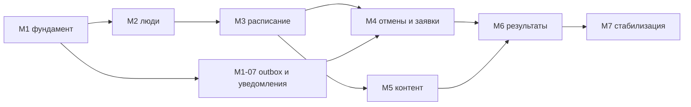

# План работ — Tutor Platform

> **Основание:** `PRODUCT-SPEC.md` v0.2 (2026-10-19). Коды правил (`CAL-01`), use-cases (`UC-14`) и решения (`Р-22`) — оттуда.
> **Части:** 1) MVP (этап 1, backend + четыре Telegram-бота); 2) оставшиеся задачи спецификации (этапы 2 и 3, платформенные работы).
> **Оценки** — в днях работы одного backend-разработчика, знакомого с TypeScript, NestJS, PostgreSQL и grammY. Это ориентир для планирования, не обязательство. Буфер на неизвестное добавлен отдельно.

## Содержание

1. [Принципы и порядок работы](#1-принципы-и-порядок-работы)
2. [MVP: план по вехам](#2-mvp-план-по-вехам)
3. [MVP: сводка, критический путь, риски](#3-mvp-сводка-критический-путь-риски)
4. [Этап 2: веб и интеграции](#4-этап-2-веб-и-интеграции)
5. [Этап 3: Mini App и расширения](#5-этап-3-mini-app-и-расширения)
6. [Платформенные и сквозные работы](#6-платформенные-и-сквозные-работы)

---

## 1. Принципы и порядок работы

**Вертикальные срезы.** Каждая веха заканчивается сценарием, который можно показать в Telegram руками: не «готов модуль», а «учитель поставил занятие и ученик получил уведомление». Внутри вехи задачи идут от схемы БД и use-case к обработчику бота.

**Порядок внутри задачи (TDD):** тест правила или use-case (красный) → реализация (зелёный) → рефакторинг → обработчик бота → e2e с подменой Telegram API. Покрытие доменной логики — не ниже 80 % (10.6).

**Definition of Done для задачи:**

- миграция обратно совместима, схема описана в `migrations/`;
- use-case проверяет права по модели 8.0 (роль + контекст + статус связи), а не только меню;
- тексты через i18n, без строк в коде обработчиков;
- действия из `AUD-01` пишутся в аудит, доменные события — через outbox;
- OpenAPI обновлён, если задача трогает REST;
- unit и интеграционные тесты зелёные в CI; e2e-сценарий добавлен, если задача закрывает use-case.

**Что фиксируется на старте (M1):** выбор ORM (Drizzle или Kysely), очередь (BullMQ или `pg-boss`, вопрос 36), версия Node LTS и PostgreSQL 16+, имена четырёх тестовых ботов для dev и staging.

**Обозначения в таблицах:** «Зависит от» — задачи, без которых нельзя начать; «Приёмка» — что показать, чтобы закрыть задачу.

---

## 2. MVP: план по вехам

### M1. Фундамент — «учитель приглашён и попал в рабочий бот» — ✅ выполнено 2026-10-19

| ID | Задача | Содержание | Зависит от | Приёмка | Дни |
|---|---|---|---|---|---|
| M1-01 | Репозиторий и окружение | Монорепо `apps/api`, `apps/worker`, `libs/*`; NestJS на Fastify, TypeScript strict; ESLint, Prettier; Docker Compose: PostgreSQL 16, Redis, MinIO; конфиг через env с валидацией; pino-логи с `correlation_id`; CI: lint, typecheck, test, build образов | — | `docker compose up` поднимает всё; CI зелёный на пустом проекте | 2 |
| M1-02 | Слой БД и тестовая инфраструктура | Выбор ORM, SQL-миграции, генерация UUID v7 в приложении, базовые таблицы (`account`, `account_role`, `bot_chat`, `consent`, `subject`), Testcontainers для PostgreSQL, Redis, MinIO; фабрики тестовых данных | M1-01 | Интеграционный тест создаёт аккаунт через миграции в контейнере | 2 |
| M1-03 | Identity: аккаунты, роли, приглашения | Роли и ограничение «один SA»; `seed:superadmin` (5.1.1, идемпотентно); приглашения учителя и админа (`INV-01…05`: одноразовость, 72 часа, привязка к user ID, хеш токена, отзыв); добавление роли существующему аккаунту; блокировка и разблокировка (`ACC-01`, `ACC-03`) | M1-02 | Unit-тесты INV и ACC; SA создан из env и принял ссылку | 2 |
| M1-04 | AuthBot: онбординг | grammY, webhook в проде и polling в dev, секрет вебхука; диалог `/start <token>`: проверка приглашения, анкета учителя (имя, предметы из справочника, часовой пояс, язык, длительность, **текст по умолчанию**, согласие с версией документа), проверка username; ссылка на StaffBot | M1-03 | e2e: приглашение → анкета → аккаунт `active` → ссылка на StaffBot | 2 |
| M1-05 | Каркас StaffBot и общая инфраструктура ботов | Один шлюз на четыре токена, сессии в Redis, сериализация апдейтов по `chat_id`, меню одним редактируемым сообщением, пагинация, `setMyCommands` по ролям, i18n (русский), короткие ключи `callback_data`, мягкий сброс диалога по TTL, обработка 403 → `bot_chat.is_reachable` | M1-04 | StaffBot показывает меню по ролям; заблокированный аккаунт получает отказ | 2 |
| M1-06 | Access: фичи, лимиты, права | Каталог фич в коде (5.3.2), три уровня значений, зависимости, лимиты, кеш в Redis со сбросом; `FEATURE_DISABLED` в use-case; guard «роль + контекст»; раздел «Администрирование» в StaffBot: пригласить учителя, список, блокировка с выбором судьбы занятий (`ACC-02`, применение — в M4-06), фичи и лимиты учителя, управление админами у SA | M1-05 | UC-04, UC-07, UC-08 проходят e2e; изменение фичи сразу меняет меню учителя | 2 |
| M1-07 | Аудит и outbox | `audit_log` (только добавление, чтение админами, `GET /admin/audit`); `outbox_event` и публикатор; каркас `notifications`: таблица, планировщик `FOR UPDATE SKIP LOCKED` каждые 30 с, очередь на бота с лимитером и `retry_after`, `dedupe_key`, журнал доставки, тип `admin.*` как первый потребитель | M1-05 | Интеграционный тест: событие из транзакции доходит до очереди ровно один раз; падение Redis не теряет уведомление | 2 |
| M1-08 | Справочник предметов и типов файлов | Таблица `subject` с предзаготовленным списком, пополнение админом в StaffBot и `/admin/subjects`; список допустимых типов файлов с правкой админом (`Р-31`, UC-44) | M1-06 | Учитель при онбординге выбирает предмет из списка, который пополнил админ | 0.5 |
| M1-09 | Смена суперадмина через API | `POST /system/super-admin/transfer` с `X-System-Key` (хеш, сравнение за постоянное время, ограничение частоты), подтверждение нового SA в AuthBot, уведомления, аудит (5.3.4) | M1-07 | UC-02 e2e | 1 |

**Итого M1: 15,5 дня.**

### M2. Люди — «у учителя есть ученики, группы, родители» — ✅ выполнено 2026-10-20

| ID | Задача | Содержание | Зависит от | Приёмка | Дни |
|---|---|---|---|---|---|
| M2-01 | Каркасы StudentBot и ParentBot | Два бота на общем шлюзе; `/start <token>` с разбором вида приглашения; упрощённый онбординг (имя, часовой пояс, согласие; у родителя — согласие за ребёнка `consent.on_behalf_of`); меню по 4.4; отказ для `blocked` | M1-05 | Оба бота отвечают на `/start`, меню по ролям | 2 |
| M2-02 | Приглашение ученика персональной ссылкой | Диалог в StaffBot: предмет из справочника, лимит занятий в неделю (`PPL-06`), необязательные имя и класс → карточка `pending` → карточка-приглашение; принятие и отклонение в StudentBot; `PPL-01…06`; `max_students`; создание трёх журналов по предмету (заглушка до M6-01); уведомление учителю и подсказки «пригласить родителя», «поставить занятие» | M2-01 | UC-10 e2e с альтернативами 3а, 5а, 5б | 2 |
| M2-03 | Родители и семейные связи | Приглашение родителя только учителем из карточки ученика → ParentBot; семейная связь общая для учителей; до 4 родителей; отзыв связи родителем, учителем-инициатором, админом; переключение ребёнка в ParentBot; список родителей у ученика только для чтения | M2-01 | UC-11 e2e с альтернативами; ученик видит родителей, но не управляет ими | 2 |
| M2-04 | Карточка ученика и профиль учителя | Карточка 5.4.1: псевдоним, класс, школа, предметы (добавление предмета → новые журналы), цели, заметки, лимит в неделю, открытость календаря, копии; настройки учителя в StaffBot: профиль, предметы, буферы, разрешения на отмену, текст по умолчанию, шаблоны причин | M2-02 | `PATCH /students/{id}`, `PATCH /me`, меню «Настройки» работают | 1.5 |
| M2-05 | Группы | Создание, предмет, эмодзи, длительность, состав, архив; изменение состава — только будущие занятия (применение — в M3-02) | M2-02 | UC-12 e2e | 1.5 |
| M2-06 | Завершение связей и модель доступа 8.0 | Отказ учителя (`removed_by_teacher`, экран последствий), уход ученика с согласием родителя (`LINK-01…05`, `leave_request`, истечение 7 дней, напоминание 48 ч), завершение родителем; последствия 5.8.4 через доменные события (отмены занятий подключаются в M4-06); политика чтения: статус аккаунта, статус связи, участие; раздел «Архив» в StudentBot; `ACC-04` для заблокированного учителя | M2-03, M1-07 | UC-33, UC-34, UC-35 e2e; ушедший ученик видит архив, заблокированный — ничего | 3 |

**Итого M2: 12 дней.**
Что отложено. Общий базовый класс для трёх диалогов завершения, подтверждение удаления шаблона, строки family.* для реестра 5.13.1 в спецификации (не вносил, спека не правилась), боты к реальному Telegram не подключались (нет токенов). Фаза M3 не начата: жду отдельной команды.

### M3. Расписание — «учитель ведёт расписание без накладок» — ✅ выполнено 2026-10-20

| ID | Задача | Содержание | Зависит от | Приёмка | Дни |
|---|---|---|---|---|---|
| M3-01 | Занятость и запрет пересечений | `occupancy` с `EXCLUDE` (7.5), `personal_block`, буферы учителя, полуоткрытые интервалы (`CAL-03`), предварительная проверка для понятной ошибки (`CAL-06`), `GET /calendar/busy` только интервалами (`CAL-07`), личные блоки учителя в StaffBot | M2-04 | Интеграционный тест гонки: из двух параллельных транзакций проходит одна; буфер зафиксирован в записи | 2 |
| M3-02 | Занятия | Создание индивидуального и группового занятия в одной транзакции с занятостью всех участников, участники, формат и место, статусы 5.6.2 (без восстановления), `lesson_event`, `version`, порядковый номер для индивидуальных, «не состоялось»; быстрое создание в StaffBot (5.6.3) без ограничения окнами (`CAL-09`); «Сегодня / Завтра / Неделя»; изменение состава группы применяется к будущим занятиям с отчётом о конфликтах | M3-01, M2-05 | UC-14 e2e с альтернативами 3а, 2а | 3 |
| M3-03 | Окна и открытые слоты | `availability_rule`, `availability_exception`, расчёт открытых слотов (окна − занятость учителя с буферами и блоками − занятость ученика) с шагом сетки и допустимыми длительностями, в часовом поясе учителя с учётом летнего времени; `GET /availability/slots`; настройка окон в StaffBot | M3-01 | Unit-тесты слотов, включая переход DST; расчёт на 3 недели ≤ 300 мс | 2 |
| M3-04 | Серии | `lesson_series` для ученика или группы, RRULE как формат хранения, разворачивание через Luxon, материализация на 12 недель фоновой задачей, отчёт о конфликтах учителю, изменения «это / это и последующие / все», пауза и завершение серии (отмены — через M4-06) | M3-02, M3-03 | UC-15, UC-39 e2e; DST-тесты серий | 3 |
| M3-05 | Итоги занятия | Переход в `awaiting_report` по окончании (`LES-01`), сообщение «Как прошло занятие» (`LES-06`), посещаемость, тема, комментарий; напоминания через 2 часа и в сводке (`LES-07`, доставка — M4-05); «Требует внимания»; `lesson.summary` ученику (`LES-08`) | M3-02, M1-07 | UC-24, UC-38 e2e | 2 |
| M3-06 | Расписание в StudentBot и ParentBot | Списки занятий по всем учителям, карточка занятия с действиями-заглушками (подключаются в M4), расписание ребёнка у родителя, видимость по 5.5.3 | M3-02, M2-01 | Ученик и родитель видят занятия в своём часовом поясе | 1 |

**Итого M3: 13 дней.**

### M4. Отмены, заявки и уведомления — «тихих отмен нет, все в курсе» — ✅ выполнено 2026-10-21

| ID | Задача | Содержание | Зависит от | Приёмка | Дни |
|---|---|---|---|---|---|
| M4-01 | Отмена занятия | `cancellation`, `cancellation_item`, `CNL-01…08`: причина обязательна, предвыбранный текст по умолчанию у учителя, шаблоны (до 10, стартовый набор), поздняя отмена по порогу, cutoff, переключатели `student_can_cancel` и `parent_can_cancel`, отмена только до начала для ученика и родителя и до окончания для учителя (`LES-03`), сообщение об отсутствии в групповом занятии; диалоги в трёх ботах; освобождение занятости; уведомления всем остальным сторонам | M3-02, M3-06 | UC-20, UC-21 e2e со всеми альтернативами | 3 |
| M4-02 | Массовая отмена | Режимы учителя (несколько, период, ученик или группа за период), ученика и родителя (все за период, у учителя за период, несколько); предпросмотр, одна причина, транзакция «всё или ничего» (`CNL-10`), исключение запрещённых, групповые → отсутствие, одно сводное сообщение получателю (`NTF-07`), опция «закрыть окна на период» | M4-01 | UC-22, UC-23 e2e | 2 |
| M4-03 | Перенос | Учитель переносит сразу (проверка занятости всех, текст по умолчанию при пустом комментарии, кнопки «ОК» и «Не могу в это время»); заявка на перенос ученика и родителя при открытом календаре — всегда с подтверждением, без удержания (`Р-24`); «просьба о переносе» при закрытом; пересчёт напоминаний (`NTF-05`) и сроков ДЗ «к следующему занятию» (хук для M5-03) | M4-01, M3-03 | UC-18, UC-19 e2e | 2 |
| M4-04 | Открытый календарь и запись | Настройки (режим, `booking_confirmation`, минимальный срок, горизонт, длительности, шаг, `max_pending_per_slot`); режим без подтверждения — занятие сразу, `lesson.created` учителю с «ОК» и «Отменить»; режим с подтверждением — `booking_request` без занятости, не больше N на пересекающееся время, список заявок у учителя, подтверждение одной с отклонением пересекающихся («слот занят» и открытые слоты), истечение по минимальному сроку; лимит занятий в неделю `PPL-06` в обоих режимах; «Записаться» в StudentBot | M3-03, M3-02 | UC-16, UC-17 e2e с альтернативами 1б, 1в, 2а, 3в; интеграционный тест гонки двух записей | 3 |
| M4-05 | Уведомления целиком | Реестр типов 5.13.1 в коде, маршрутизация по боту получателя, копии родителям (`NTF-01…03`: умолчания учителя, переопределение по ученику, отключение некритичных родителем, подпись «Копия для Пети»), `NTF-04` при 403, напоминания о занятиях (до трёх интервалов на пользователя, пересчёт при переносе, снятие при отмене), тихие часы (`NTF-06`), агрегирование отметок (`NTF-07`), дедупликация (`NTF-08`), повторы и 403 (`NTF-09`), утренняя сводка учителю в выбранное время, настройки уведомлений в трёх ботах | M1-07, M4-01 | UC-37, UC-41 e2e; unit-тесты копий, тихих часов, выбора бота; напоминание уходит не позже минуты после срока | 4 |
| M4-06 | Автоматические отмены | Подписка на события: завершение связи, исключение из группы, блокировка с отменой (`ACC-02`), пауза и завершение серии — отмена будущих занятий с исходным сообщением (5.7.6); отклонение ожидающих заявок; закрытие активных ДЗ (хук для M5-03) | M4-01, M2-06, M3-04 | Сценарии 5.7.6 покрыты интеграционными тестами | 1 |

**Итого M4: 15 дней.**

### M5. Учебный контент — «задал → сдал → проверил в Telegram» — ✅ выполнено 2026-10-25

| ID | Задача | Содержание | Зависит от | Приёмка | Дни |
|---|---|---|---|---|---|
| M5-01 | Файлы | Поток 7.5: скачивание из Telegram, тип по сигнатуре (`HW-01`), подключаемый антивирус (`HW-05`, `scan_status`), загрузка в MinIO с закрытыми бакетами и случайными ключами, `file.owner_teacher_id` и учёт квоты учителя (`storage`, `Р-27`), лимиты частоты для учеников в Redis (`HW-07`), кеш `file_id` по ботам, подписанные ссылки, деградация при недоступном антивирусе (10.4) | M1-07 | Интеграционные тесты пайплайна и квоты; файл из StudentBot приходит учителю в StaffBot и родителю в ParentBot | 3 |
| M5-02 | Материалы, подборки, выдачи | Материал (файл, ссылка, текст), загрузка через StaffBot (отправить файл → название, подборка, кому выдать), плоские подборки с периодом, выдачи ученику или группе (включая новых участников), отложенное открытие и срок, выдача через занятие «до» или «после», `MAT-01…02`, отметка «просмотрено», раздел «Материалы» в StudentBot, уведомление `material.granted` | M5-01, M3-05 | UC-25 e2e | 3 |
| M5-03 | Задания | `assignment`, `assignment_target` с `due_at` на адресата (фиксированный срок, «к следующему занятию», без срока; пересчёт при переносе), статусы 5.10.2, публикация и закрытие, правила сдачи, оценивание (без оценки, зачёт, отметка в журнал — связь с M6), фоновая просрочка (UC-40), напоминания о сроке, снятие при завершении связи; выдача из итогов занятия | M5-02 | UC-26 e2e; unit-тесты сроков по адресатам | 2 |
| M5-04 | Сдача и проверка | Сдача в StudentBot несколькими сообщениями (файлы, фото, альбомы `HW-02`, текст), подсказка «как файл» (`HW-03`), черновик 24 ч (`HW-06`), предпросмотр; очередь «На проверке (N)» в StaffBot, карточка сдачи, «Принять», «На доработку» с комментарием, «Оценить» (M6), «Комментарий», «Прикрепить проверенный файл»; результат ученику и копия родителю; статистика выполнения для отчётов | M5-03, M5-01 | UC-27, UC-28 e2e со всеми альтернативами | 3 |

**Итого M5: 11 дней.**

### M6. Результаты — «родитель получает отчёт»

| ID | Задача | Содержание | Зависит от | Приёмка | Дни |
|---|---|---|---|---|---|
| M6-01 | Журналы и шкалы | Автосоздание трёх журналов на предмет связи (`JRN-01…02`), платформенная 10-балльная шкала, кастомная шкала учителя (2–10 значений, текст и эмодзи, порядок, вес, `JRN-06`), записи с категорией, весом, комментарием, ссылками на занятие и задание, история правок (`JRN-05`), видимость по журналу (`JRN-04`), внесение отметки учеником или родителем со статусом `pending` и подтверждением учителя; выставление из итогов занятия, из проверки ДЗ и вручную; для группы — по списку | M2-02, M3-05, M5-04 | UC-29, UC-30 e2e; unit-тесты шкал | 3 |
| M6-02 | Журнал тестов и статистика | Виды тестов (настраиваемый список), баллы и максимум, части A и B, вложение, целевой балл; показатели: последний, изменение, лучший, среднее за период, сравнение в процентах; средний балл за произвольный период с весами для школьного журнала; `GET /journals/{id}/stats?from&to`; список с ▲▼ в ботах | M6-01 | Unit-тесты расчётов | 2 |
| M6-03 | Отчёт успеваемости | Сбор за месяц или диапазон (занятия, посещаемость, отмены с поздними, ДЗ, средний балл, тесты, кастомная сводка, комментарий учителя), снимок `report.snapshot`, отправка ученику и копией родителям (`report.sent`), просмотр прошлых отчётов | M6-02, M4-05 | UC-31 e2e; отчёт открывается из ParentBot | 2 |
| M6-04 | ICS-подписка | Секретная ссылка на календарь для учителя, ученика, родителя (занятия детей), минимум деталей, перевыпуск (`POST /ics/rotate`), фича `calendar.ics` | M3-02 | Подписка открывается в Google Calendar и Apple Calendar | 1 |
| M6-05 | «Успеваемость» в StudentBot и ParentBot | Журналы по учителям и предметам с учётом видимости, внесение школьной отметки, отчёты; настройка копий `cc_rule` в StaffBot (UC-32) | M6-01, M4-05 | UC-36 e2e | 1 |

**Итого M6: 9 дней.**

### M7. Стабилизация — «готово к пилоту»

| ID | Задача | Содержание | Зависит от | Приёмка | Дни |
|---|---|---|---|---|---|
| M7-01 | Нагрузочные тесты | Отправка уведомлений (лимиты Telegram, очередь), расчёт слотов, массовая отмена на 100 учителей и 3 000 учеников (10.3) | M4-05 | Отчёт с p95 и узкими местами, исправления | 2 |
| M7-02 | Наблюдаемость и алерты | Метрики API, очередей и доставки, трассировка OpenTelemetry, Sentry, Prometheus и Grafana, алерты по ошибкам доставки и отставанию напоминаний (10.5) | M1-01 | Дашборд и три алерта срабатывают на синтетических сбоях | 1.5 |
| M7-03 | Бэкапы и восстановление | WAL-архивирование (WAL-G или pgBackRest), версионирование бакетов MinIO, учение по восстановлению на момент времени (RPO 5 минут, RTO 4 часа) | M1-01 | Протокол восстановления на staging | 1 |
| M7-04 | Безопасность | Проверка по чек-листу 10.1: секреты, вебхуки, подписанные ссылки, ограничение частоты, ошибки без утечек, зависимости в CI; ревью прав по 8.0 на всех use-case | все | Отчёт без критичных находок | 1.5 |
| M7-05 | Юридические тексты и согласия | Политика конфиденциальности, оферта, версионирование документов в `consent`, экран согласия в трёх ботах, проверка с юристом (вопрос 33) | M2-01 | Тексты утверждены, версия зафиксирована | 1 (без времени юриста) |
| M7-06 | Пилот | Staging с отдельными ботами, онбординг 3–5 учителей, сбор обратной связи, буфер на исправления | все | Пилот идёт две недели без блокирующих ошибок | 3 |

**Итого M7: 10 дней.**

---

## 3. MVP: сводка, критический путь, риски

### 3.1 Сводка

| Веха | Дней | Накопительно |
|---|---|---|
| M1 Фундамент | 15,5 | 15,5 |
| M2 Люди | 12 | 27,5 |
| M3 Расписание | 13 | 40,5 |
| M4 Отмены, заявки, уведомления | 15 | 55,5 |
| M5 Учебный контент | 11 | 66,5 |
| M6 Результаты | 9 | 75,5 |
| M7 Стабилизация | 10 | 85,5 |
| Буфер 20 % (неизвестное, ревью, правки по пилоту) | 17 | около 103 |

Один разработчик: около 5 месяцев при полной занятости. Два разработчика: около 3 месяцев — см. параллелизацию ниже.

### 3.2 Критический путь

Критический путь: M1 → M2 → M3 → M4 → M6 → M7. Самая длинная и рискованная задача на нём — M4-05 (уведомления целиком); её стоит начать параллельно с M3.

### 3.3 Параллелизация для двух разработчиков

| Поток A (домен расписания) | Поток B (люди, контент, уведомления) |
|---|---|
| M1-01, M1-02, M1-03 | M1-05 (после M1-04), M1-06, M1-07, M1-08 |
| M1-04 AuthBot | M2-01, M2-03, M2-06 |
| M3-01, M3-02, M3-03, M3-04 | M2-02, M2-04, M2-05, затем M4-05 |
| M4-01, M4-02, M4-03, M4-04 | M5-01, M5-02, M5-03 |
| M3-05, M4-06, M6-04 | M5-04, M6-01, M6-02, M6-03, M6-05 |
| M7-01, M7-03 | M7-02, M7-04, M7-05 |

Точки синхронизации: конец M1 (общие контракты модулей), M3-02 (занятие как сущность нужно обоим потокам), M4-05 (события всех модулей).

### 3.4 Риски MVP и что делать

| Риск | Где стреляет | Мера |
|---|---|---|
| Летнее время и серии: экземпляры «уезжают» на час | M3-03, M3-04 | Хранить локальное время и IANA-зону, разворачивать через Luxon, DST-тесты до реализации |
| Лимиты Telegram и 429 при массовых отменах и утренних сводках | M4-02, M4-05 | Очередь на бота с лимитером, агрегирование, `retry_after`; нагрузочный тест в M7-01 |
| Параллельные апдейты ломают многошаговые диалоги | M1-05 | Сериализация по `chat_id` с первого дня, e2e с параллельными апдейтами |
| Гонки записи без подтверждения | M4-04 | `EXCLUDE` в БД, интеграционный тест на параллельные транзакции |
| Файлы: антивирус и память на одном сервере | M5-01 | Подключаемый шаг, `scan_status = skipped` в локальном тесте, ClamAV отдельным контейнером позже |
| Квота и лимиты частоты обходятся альбомами и повторными сдачами | M5-01, M5-04 | Считать каждый файл альбома, счётчики в Redis, тесты на границы |
| Четыре бота и «учитель + родитель» в трёх чатах | M2-01 | Единые подписи сообщений, кнопка «Написать учителю» везде, e2e на аккаунт с несколькими ролями |
| Юридическая проверка затягивает релиз | M7-05 | Начать тексты и запрос юристу на M5, не на M7 |
| Рост объёма: «ещё одну кнопку» | все | Любое новое требование — через журнал решений в разделе 12 спецификации, не через чат |

---

## 4. Этап 2: веб и интеграции

Цель этапа — веб-клиент для админов и учителей на том же API, интеграции и всё, что перенесено из MVP решением `Р-30`. Размеры: S — 1–3 дня, M — 4–8, L — 9–15, XL — больше 15.

### 4.1 Порядок

1. **AUTH и каркас веба** открывают всё остальное: импорт CSV, графики, PDF, статистика живут в вебе.
2. **Google Calendar** — начать рано: проверка OAuth-приложения в Google занимает недели календарного времени независимо от объёма кода.
3. **Переносы из MVP** — мелкие и независимые, закрывают обратную связь пилота; делать между крупными эпиками.
4. **Учебные периоды и шкалы** — к началу учебного года, когда появится спрос на четвертные.

### 4.2 Эпики

| ID | Эпик | Содержание | Зависит от | Размер |
|---|---|---|---|---|
| E2-01 | Вход в веб (AUTH) | Код по username из AuthBot (`AUTH-01…04`), access и refresh токены с ротацией, `web_session`, список сессий и «выйти везде» в AuthBot и вебе, уведомления о входе, отзыв сессий при блокировке; команды `/login`, `/sessions`, `/logout_all` | MVP | M |
| E2-02 | Веб-клиент: каркас | Выбор фронтенд-стека (в спецификации не задан; кандидат — React с TypeScript), сборка, авторизация, роутинг по ролям, дизайн-система, i18n | E2-01 | L |
| E2-03 | Веб-клиент: учитель | Ученики и карточки, группы, календарная сетка (неделя и месяц) с созданием и переносом, материалы и файлы (загрузка через подписанные ссылки, файлы больше 20 МБ), сдачи, журналы с интерактивными графиками, отчёты, настройки | E2-02 | XL |
| E2-04 | Веб-клиент: админ | Пользователи, фичи и лимиты, приглашения, справочники, аудит, статистика (`Р-30`), пресеты фич | E2-02 | L |
| E2-05 | Google Calendar | OAuth 2.0 со скоупами `calendar.app.created` и `calendar.freebusy`, экспорт занятий в отдельный календарь, импорт занятости как мягкой блокировки (`external_busy`), синхронизация по расписанию и push, шифрование токенов, отключение; проверка приложения в Google (UC-43) | E2-01 | L |
| E2-06 | Графики и PDF | Картинка недели и графики динамики тестов рендером на сервере для ботов; PDF-отчёт; шаблон отчёта | MVP | M |
| E2-07 | Telegram-группы классов | Фича `groups.telegram`: `/link <код>` в группе, privacy mode, дублирование объявлений, ДЗ группы и изменений расписания; личное в группу не попадает (4.3) | E2-09 | M |
| E2-08 | Способы добавления учеников | Групповая ссылка с лимитом, сроком и подтверждением вступления (`invite.group_link`), QR-код, выбор контакта `request_users`, импорт CSV в вебе | E2-03 | M |
| E2-09 | Объявления | Фича `broadcasts`: объявление ученикам, группе, всем; копия родителям; вложения; лимит 10 в день; тип `announcement` | MVP | S |
| E2-10 | Кастомный журнал: картинки | Картинки значений (PNG, JPG, WEBP до 512 КБ), отправка стикером или фото в ботах, показ в вебе | MVP | S |
| E2-11 | Сдачи: голосовые и EXIF | Приём голосовых (OGG) для языковых репетиторов, удаление EXIF через `sharp` (`HW-04`) | MVP | S |
| E2-12 | Заявки и занятия: дополнительные ветки | «Предложить другое время» (`POST /bookings/{id}/counter`), восстановление отменённого занятия (`LES-04`, `/restore`), подтверждение «Буду» в напоминании | MVP | M |
| E2-13 | Автоматический отчёт | Черновик в конце месяца, напоминание учителю, автоотправка по настройке | MVP | S |
| E2-14 | Разделы в подборках | `collection_item.section`, навигация по разделам в ботах и вебе | MVP | S |
| E2-15 | Учебные периоды и шкалы | `academic_period` (год, четверти, полугодия, триместры; даты по умолчанию от админа), прогноз четвертной с настраиваемым округлением, фактические четвертные и годовые, расчёт годовой; другие шкалы школьного журнала (5-, 12-балльная, своя числовая), выбор страны | MVP | M |
| E2-16 | Выгрузка персональных данных | Экспорт своих данных по запросу (ученик, родитель, учитель) в архив; процедура обезличивания с решением по файлам сдач (вопрос 35) | E2-01 | M |
| E2-17 | Учебный план 💡 | Темы курса и прогресс ученика по ним, связь с занятиями и подборками | E2-03 | M |

**Примерный объём этапа 2:** 80–110 дней одного разработчика; веб-клиент (E2-02…E2-04) — больше половины. Разумно подключить фронтенд-разработчика с E2-02.

---

## 5. Этап 3: Mini App и расширения

| ID | Эпик | Содержание | Зависит от | Размер |
|---|---|---|---|---|
| E3-01 | Mini App в StaffBot | Тот же веб-клиент, адаптированный под Telegram; авторизация по `initData` (HMAC, срок действия), фича `miniapp` | E2-03 | L |
| E3-02 | REST для ученика и родителя | Эндпоинты `/student/*` и `/parent/*` над существующими use-cases: расписание, запись, отмены, ДЗ, сдачи, материалы, журналы, отчёты, согласия | MVP | M |
| E3-03 | Mini App в StudentBot и ParentBot | Календарь, графики успеваемости, сдачи с предпросмотром | E3-01, E3-02 | L |
| E3-04 | Модель монетизации | Решение по вопросу 34 (фичи, подписка, сочетание); тарифы как наборы фич и лимитов поверх `feature` и `account_feature`; оплата только с учителей | E2-04 | M (без провайдера оплаты) |
| E3-05 | Учёт оплат и абонементов 💡 | Абонементы, списания за занятия, поздние отмены как платные (`CNL-06`), выбор платёжного провайдера, чеки, юридические требования | E3-04 | XL |
| E3-06 | Аналитика для учителя | Загрузка по неделям, отмены и поздние отмены по ученикам, доходимость ДЗ, динамика тестов по всем ученикам | E2-03 | M |
| E3-07 | Telegram Business | Исследование: бот пишет в нативные чаты от имени учителя; ограничения 24-часового окна и Premium; решение «делать или нет» | MVP | S |
| E3-08 | ИИ-помощники 💡 | Черновик отчёта по данным журналов, разбор сдачи; только по запросу пользователей, с явным согласием на обработку | E3-02 | M |
| E3-09 | Английский интерфейс | Перевод i18n-ресурсов четырёх ботов и веба, форматы дат (`Р-19`, не скоро) | E2-03 | M |

---

## 6. Платформенные и сквозные работы

Делаются по мере роста нагрузки, не привязаны к этапам.

| ID | Работа | Когда | Размер |
|---|---|---|---|
| P-01 | Row-Level Security в PostgreSQL как второй рубеж прав (10.1) поверх денормализованного `teacher_id` (8.0) | После пилота, до публичного релиза | M |
| P-02 | Партиционирование `audit_log` и `notification` по месяцам, политика хранения по решению вопроса 33 | При росте объёма или к релизу | S |
| P-03 | Выделение сервисов: шлюз ботов и уведомления; NATS JetStream вместо BullMQ как транспорт outbox (7.3) | Когда один сервер перестанет справляться | L |
| P-04 | Kubernetes или managed-сервисы, отказоустойчивый PostgreSQL, реплики | Вместе с P-03 | L |
| P-05 | Собственный Bot API сервер ради файлов до 2 ГБ | Только по запросу пользователей (`Р-15`) | S |
| P-06 | Регулярный аудит безопасности и зависимостей, ротация секретов и ключа SA | Ежеквартально | S |
| P-07 | Юридический контур: политика, оферта, место хранения данных при выходе за пределы РБ | При расширении географии | M |
